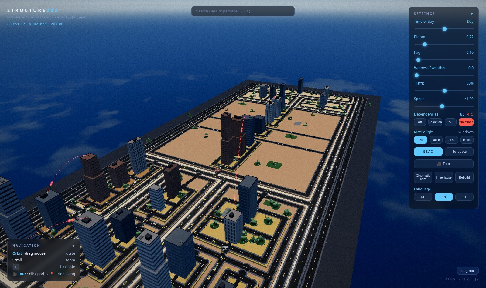
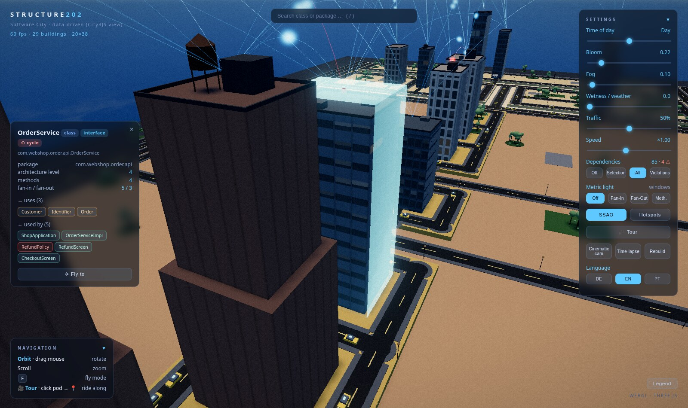

# 3D Views

[Handbook home](README.md) · [Layered Architecture View](layered-view.md) ·
[The window](window.md) · [Reference](reference.md)

There are two, for different purposes: **3D Architecture** is a second look at the active tab, and
**City3D** a city in the browser, good for showing a system to others.

## 3D Architecture

**View → 3D Architecture** opens a tab that shows the active view tilted into space. The
arrangement is the same: packages are slabs lying on each other, classes are blocks. The higher a
block, the higher the [global level](concepts.md#levels-and-layers) of the class.

The tab follows the switches of the view it shows:

| Switch | Draws |
| --- | --- |
| Show Dependencies | For the selected element: blue arcs to what it uses, green arcs from what uses it. |
| Class SCCs | Class cycles, red. |
| Show Violations | Violations of the layers, orange. |

The selection is shared with the view and the outline. The label at the top left names the selected
element.

| Mouse and keyboard | Effect |
| --- | --- |
| Moving | Highlights the block or slab under the pointer. |
| Click | Selects it. The first click also lets the tab take the keyboard. |
| W, A, S, D | Fly forward, left, backward, right. |
| Ctrl and moving the mouse | Look around. |
| Ctrl and mouse wheel | Fly nearer or further away. |
| Esc | Gives the keyboard back. |

As long as the tab has the keyboard, no other shortcut of S202 works. **File → Export Image...**
saves this picture while the tab has the focus.

## City3D

**File → Show City3D View** opens what the active tab shows as a city in the browser: from a scope
tab only the scope, from a tangle tab the whole analysis. S202 serves the city to this machine only;
the browser must run there, and S202 must stay open.

| In the city | Meaning |
| --- | --- |
| Building | A class. |
| Height | The number of methods. |
| Ground area | How many classes use it, and how many it uses. |
| Glass, brick or stone, concrete | High, middle and low global level. Interfaces are always glass. |
| Terrace | A package; terraces lie on each other as packages are nested, and the rows of buildings are the layers. |
| Red terrace | The package is part of a package cycle. |
| Blinking red light on a roof | The class is at one end of a [back-edge](concepts.md#violations). The legend calls it *class in a cycle*. |
| Cab | A dependency across packages, driving from the user to the used. |
| Pedestrian | A dependency inside a package. |
| Cyan or red light | The dependency follows the layers, or violates them. |
| Speed | The difference of the levels. |

|  |
| --- |

The button **Legend** at the lower right shows this in the city.

### Finding a class

The field at the top finds classes and packages; the key `/` gets there. A click on a building or a
terrace selects it and shows what it is, what it uses and who uses it. The names lead on to those
classes. A selection in the city is also one in S202, and the other way round.

| Action | Effect |
| --- | --- |
| Dragging, mouse wheel | Turns the city, zooms. |
| F | Flying with W, A, S, D, up and down with E and Q, faster with Shift, Esc to stop. |
| Click | Selects; another click lifts the selection. |
| Double-click | Flies there. |
| Click on a cab or pedestrian | Shows the dependency and its route. **Follow** rides along. |

### Settings

| Control | Effect |
| --- | --- |
| Time of day, Bloom, Fog, Wetness | Light and weather. At night windows and roof lights stand out. |
| Traffic, Speed | How many dependencies drive, and how fast. |
| Dependencies | Arcs from roof to roof: none, those of the selection, all, or the violations only. The number counts them. |
| Metric light | Lights the windows by fan-in, fan-out or the number of methods. |
| SSAO | Shading; switch it off in a huge city to make it faster. |
| Hotspots | Highlights the busiest crossings. |
| Tour | Follows a random cab or pedestrian; Esc stops. |
| Cinematic cam, Time-lapse | Turns the city slowly; runs through a day. |
| Rebuild | Builds the city anew. |
| Language | German, English or Portuguese. |

The city shows what was open when the menu entry was chosen. Choose it again after switching to
another tab.

In a build from source the city needs its web bundle, which `build-all.sh` builds if Node.js 18 or
newer is installed.

[Next: Quality →](quality.md)
