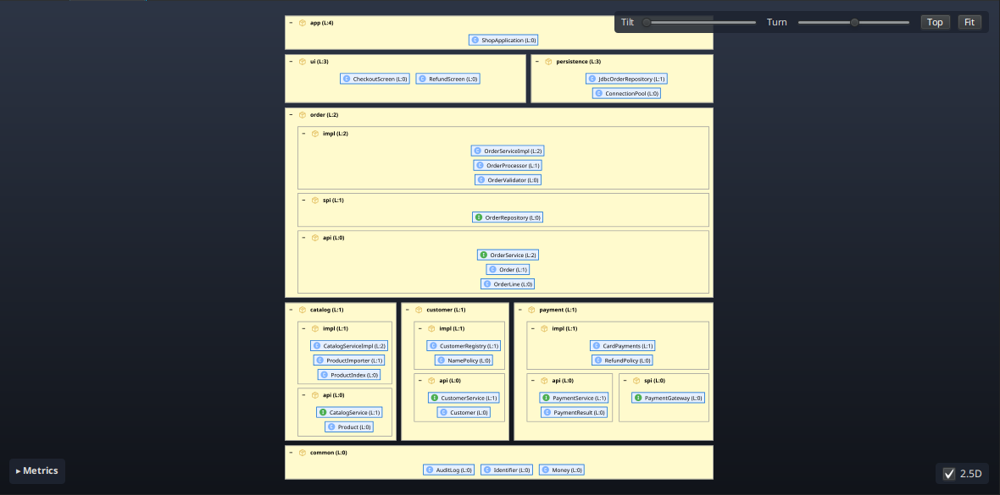
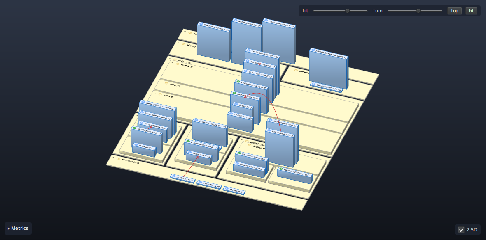
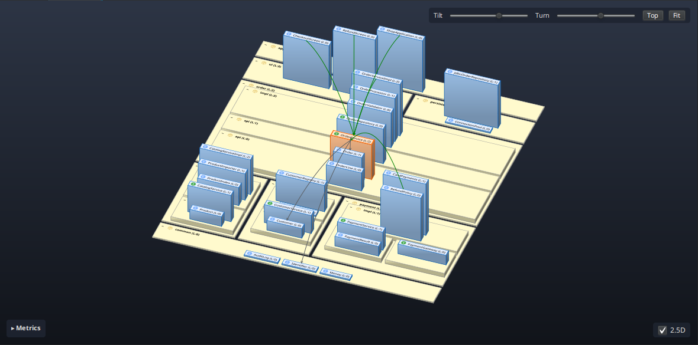
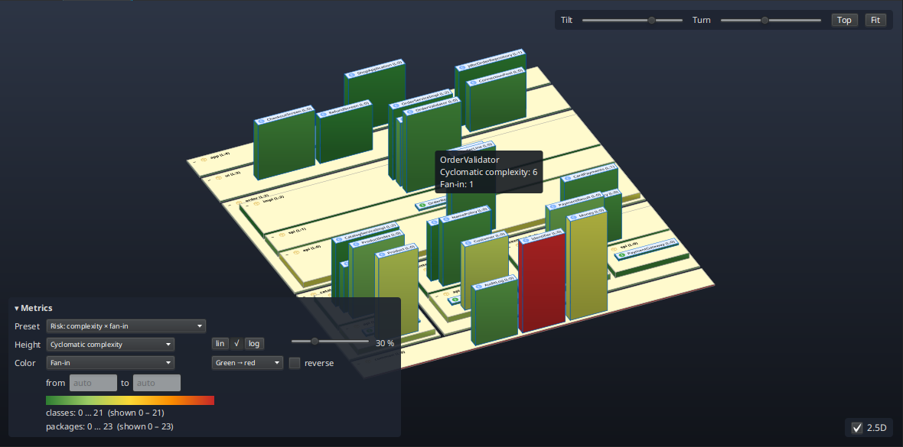
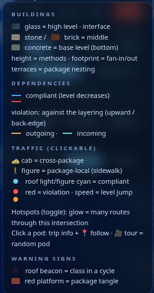

# 3D Views

[Handbook home](README.md) · [Layered Architecture View](layered-view.md) ·
[The window](window.md) · [Reference](reference.md)

There are two, for different purposes: **3D Architecture** is a second look at the active tab, and
**City3D** a city in the browser, good for showing a system to others.

## 3D Architecture

**View → 3D Architecture** opens a tab with the active view once more, as boxes that have a
height. Seen from above it is the 2D picture: every box has its place and size and shows on top
what it shows there, name, icon and level, in the same fonts. The heights cannot be seen yet.

Tilted back, the boxes show their sides. An open package is a base lying on the package it is in,
and classes stand on their package. How high a class stands, and what the colour of its sides
says, is set under [Metrics](#metrics); at first the height is its
[global level](concepts.md#levels-and-layers). A closed package stands for what is in it: it is as
high as its highest class. The labels stay on top and stay sharp at any zoom, because they are
drawn as text, not as a picture.

### 2.5D Architectural Metric Projection

The tab does not lay the system out anew. It takes the picture of the layered view as it is and adds
one dimension to it:

- At 0° tilt it is the architecture diagram you work with.
- Tilting it back makes a further dimension of information visible.
- Another metric changes only the heights and the colours of the sides. Where a box lies, how large
  it is and what it says stay as they are.
- Tilted back to 0°, it is exactly the diagram it was.

It is a metric extension of a layout that already exists, not a new layout. A city like
[City3D](#city3d) arranges the classes in a layout of its own; this view keeps the one of the
diagram, so nothing has to be found again. You can work with the 2D picture all day and turn to the
third dimension only when a concrete question needs it: which of these classes are complex and used
by many, how far a change can spread, where a package depends on more than it should.

### Moving, tilting, clicking

| Mouse | Effect |
| --- | --- |
| Dragging up or down | Tilts the picture back or forward: down tilts it back, up to 80°; 0° is the view from above. |
| Dragging left or right | Turns it about the vertical axis; the front edge goes with the mouse. |
| Dragging with the right button, or with Shift | Moves it. |
| Mouse wheel, with Shift sideways | Moves it up and down, or sideways. |
| Ctrl and mouse wheel | Zooms about the pointer. |
| Mouse over a box | A small label names the box and its values. With **Show Dependencies** its arrows stand out and the boxes they connect it with turn green, as in 2D. |
| Mouse over an arrow | The arrow gets thicker. |
| Click on a box | As in 2D: **−** or **+** closes or opens a package, anything else selects; a double-click is one there too. A click beside all boxes lifts the selection. |
| Click on an arrow | Selects it and fills [Dependency Details](window.md#dependency-details). |
| Right-click | The menu of 2D: on a box **Open Scope**, From / To and the [marks](layered-view.md#transitive-users-and-dependencies), on an arrow between two classes **Cut** or **Restore**. |

Moving and zooming work as in the [Layered Architecture View](layered-view.md); tilting and turning
come in addition.

**Tilt** and **Turn** at the top right do the same with sliders, **Top** goes back to the view from
above, **Fit** fits the whole picture into the tab. The view keeps tilt, turn and zoom while the
picture changes, for instance when a package is opened.

The tab shows the arrows of the view it shows, with their colours and patterns: what
**Show Dependencies**, **Class SCCs**, **Package Cycles** and **Show Violations** draw there. Each
arrow rises from the top of its source in an arc over the boxes in between and comes down on the
top of its target; from above it is the line of the 2D picture.

Selection, open packages, cuts and marks are those of the view: what is done in the tab is done
there, and the other way round. **File → Export Image...** saves this picture while the tab has the
focus.

### Metrics

**▸ Metrics** at the lower left opens the settings of what heights and colours show. Every change
is drawn at once.

| Setting | Effect |
| --- | --- |
| Preset | A setting for a question of a review, see below. |
| Height | The metric that says how high classes and closed packages stand. |
| lin, √, log | How values become heights. With √ or log a few large values flatten the rest less. |
| Percent | The height of the largest value, in percent of the size of the picture: the same setting fits a small system and a large one. Below, the values the heights span. |
| Color | The metric that colours the sides; **None** keeps the colours of 2D. The tops always keep them, so from above the picture stays the 2D picture. |
| Palette, reverse | Green to red, Viridis (readable without telling red from green) or blue to red; **reverse** for metrics where small is bad. |
| from, to | The values at the ends of the palette; empty for the smallest and largest shown. Below, the values the palette spans, for classes and for open packages. |

Another metric or scale for the height brings the whole picture back into the tab; the percent and
the colours leave the view as it is. Classes are measured against the classes shown, open packages
against the open packages. A closed
package has the values of its highest class, so closing a package does not change the skyline. The
setting belongs to the analysis and is saved with the [project](projects-and-export.md).

| Metric | Of a class | Of a package |
| --- | --- | --- |
| Architecture level | Its [global level](concepts.md#levels-and-layers). | Its level among the packages. |
| Size | Its methods. | Its classes. |
| Lines of code | Lines with code. | Of all its classes. |
| Cyclomatic complexity | All its methods together: one path per method and one more for every branch, case and catch. | Of all its classes. |
| Max method complexity | Of its most complex method. | Of the most complex method in it. |
| Fan-in | Classes that use it. | Classes outside it that use one of its classes. |
| Fan-out | Classes it uses. | Classes outside it that its classes use. |
| Instability | Fan-out / (fan-in + fan-out): 0 is only used, 1 only uses. | The same over the package. |
| Abstractness | 1 for an interface. | Its share of interfaces. |
| Distance from main sequence | \|abstractness + instability − 1\| | The same over the package: 0 is balanced, 1 is concrete and much used, or abstract and unused. |
| Calls | Calls of methods of other classes, every place counted. | Of all its classes. |
| External dependencies | Classes outside the analysis it uses. | Used by its classes. |
| Transitive users | Classes that use it over any number of steps: what a change can reach. | Classes outside it that do. |
| Transitive dependencies | Classes it uses over any number of steps. | Classes outside it that its classes do. |
| Cycle size | The classes of the cycle it lies on, 0 for none. | Its classes that lie on a cycle. |

Lines and complexity are read from Java bytecode; for Python, Go, JavaScript and C they are not
measured and offered greyed. The complexity is counted in the compiled code, which has a few
branches the source does not show, for instance for a `switch` on strings: it is near the number of
the source, not the same. Project files saved before these were measured have no values for them;
open the code again.

| Preset | Height | Color | Question |
| --- | --- | --- | --- |
| Architecture levels | Level | 2D | The layers, as the tab first shows them. |
| Risk | Cyclomatic complexity | Fan-in | High and red: complex and used by many. |
| Stability | Fan-in | Instability | What many rely on should be stable. |
| Impact of a change | Transitive users | Cycle size | What a change can reach, and where cycles make it worse. |
| Size | Lines of code | Max method complexity | Large classes, and the hard methods in them. |
| Main sequence | Abstractness | Distance from main sequence | Concrete packages many rely on, and abstract ones no one uses. |

## City3D

**File → Show City3D View** opens what the active tab shows as a city in the browser: from a scope
tab only the scope, from a tangle tab the whole analysis. S202 serves the city to this machine only;
the browser must run there, and S202 must stay open.

| In the city | Meaning |
| --- | --- |
| Building | A class. |
| Height | The number of methods. |
| Ground area | How many classes use it, and how many it uses. |
| Glass, brick or stone, concrete | High, middle and low global level. Interfaces are always glass. |
| Terrace | A package; terraces lie on each other as packages are nested, and the rows of buildings are the layers. |
| Red terrace | The package is part of a package cycle. |
| Blinking red light on a roof | The class is at one end of a [back-edge](concepts.md#violations). The legend calls it *class in a cycle*. |
| Cab | A dependency across packages, driving from the user to the used. |
| Pedestrian | A dependency inside a package. |
| Cyan or red light | The dependency follows the layers, or violates them. |
| Speed | The difference of the levels. |

|  |
| --- |

The button **Legend** at the lower right shows this in the city.

### Finding a class

The field at the top finds classes and packages; the key `/` gets there. A click on a building or a
terrace selects it and shows what it is, what it uses and who uses it. The names lead on to those
classes. A selection in the city is also one in S202, and the other way round.

| Action | Effect |
| --- | --- |
| Dragging, mouse wheel | Turns the city, zooms. |
| F | Flying with W, A, S, D, up and down with E and Q, faster with Shift, Esc to stop. |
| Click | Selects; another click lifts the selection. |
| Double-click | Flies there. |
| Click on a cab or pedestrian | Shows the dependency and its route. **Follow** rides along. |

### Settings

| Control | Effect |
| --- | --- |
| Time of day, Bloom, Fog, Wetness | Light and weather. At night windows and roof lights stand out. |
| Traffic, Speed | How many dependencies drive, and how fast. |
| Dependencies | Arcs from roof to roof: none, those of the selection, all, or the violations only. The number counts them. |
| Metric light | Lights the windows by fan-in, fan-out or the number of methods. |
| SSAO | Shading; switch it off in a huge city to make it faster. |
| Hotspots | Highlights the busiest crossings. |
| Tour | Follows a random cab or pedestrian; Esc stops. |
| Cinematic cam, Time-lapse | Turns the city slowly; runs through a day. |
| Rebuild | Builds the city anew. |
| Language | German, English or Portuguese. |

The city shows what was open when the menu entry was chosen. Choose it again after switching to
another tab.

In a build from source the city needs its web bundle, which `build-all.sh` builds if Node.js 18 or
newer is installed.

[Next: Quality →](quality.md)
