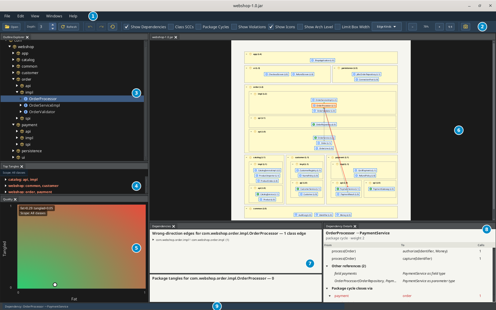

# S202 Handbook

S202 reads compiled Java code or the source code of another language, computes which part
depends on which, and draws the result as layers: what is used lies below what uses it. A
dependency that runs upwards is a finding, and so is a group of packages or classes that depend
on each other in a circle.

It is a tool for the architect of an existing system. It answers questions such as *what are the
layers of this system*, *which dependency breaks them*, *what would have to be cut to get rid of
this cycle* and *what happens if this class moves there*, and it turns the answers into a list of
changes that can be given to the developers. The analyzed code is never changed.

This handbook describes every view, panel, menu and dialog of S202 with pictures of the running
application. It describes release 1.5.0.



## Choose a path

- **First use:** [Concepts](concepts.md) → [Getting started](getting-started.md) →
  [The window](window.md)
- **Understand a system:** [Loading code](loading-code.md) →
  [Layered Architecture View](layered-view.md) → [Quality](quality.md)
- **Resolve cycles:** [Tangles](tangle-view.md) → [Planning a refactoring](refactoring.md)
- **Draw component boundaries:** [Component View](component-view.md) →
  [Planning a refactoring](refactoring.md)
- **Look up every menu, button and file:** [Reference](reference.md)

## What is covered

| Topic | Page |
| --- | --- |
| Dependencies, levels, violations, cycles, tangles, components | [Concepts](concepts.md) |
| Installation, the first analysis step by step | [Getting started](getting-started.md) |
| JARs, Maven and Gradle projects, Python, Go, JavaScript and C source, what is left out | [Loading code](loading-code.md) |
| The window part by part: menus, toolbar, tabs, panels, status bar | [The window](window.md) |
| Reading the layers, arrows, overlays, filters, scopes, moving boxes | [Layered Architecture View](layered-view.md) |
| Top Tangles, the Tangle View, cutting dependencies | [Tangles](tangle-view.md) |
| API and implementation, violations of the boundary, planned packages | [Component View](component-view.md) |
| Core, application and adapters, ports | [Hexagonal View](hexagonal-view.md) |
| The architecture in three dimensions, in the window and as a city in the browser | [3D views](3d-views.md) |
| The fat/tangled plot and the Quality Report | [Quality](quality.md) |
| From a finding to a list of changes; the reports, undo and reset | [Planning a refactoring](refactoring.md) |
| Project files, what is remembered, pictures and reports | [Projects and export](projects-and-export.md) |
| Menus, toolbar, mouse and keyboard, files, settings, status of the features, known limitations | [Reference](reference.md) |

## The sample project

Most pictures show the same small system, a web shop of 29 classes. Its source code is in
[example/webshop](example/webshop), so every picture can be reproduced:

```bash
cd docs/handbook/example/webshop
mvn package                      # produces target/webshop-1.0.jar
```

The shop is mostly well structured: `order`, `payment`, `catalog` and `customer` are components
with an `api` and an `impl` package, above them are `ui`, `persistence` and `app`, below them is
`common`. It has five deliberate defects, each marked in the source code, and the handbook finds
all of them:

| Defect | Where | Kind |
| --- | --- | --- |
| `RefundPolicy` in `payment` asks `order` back, which uses `payment` itself | `payment` → `order` | package cycle |
| `AuditLog` in the foundation knows `Customer`, which calls it in turn | `common` → `customer` | class cycle across packages |
| `OrderValidator` calls back its `OrderProcessor` | inside `order.impl` | class cycle inside a package |
| The interface `CatalogService` hands out a class of the implementation | `catalog.api` → `catalog.impl` | API leak, and a package cycle |
| `RefundScreen` uses the implementation of `payment` instead of its API | `ui` → `payment.impl` | API bypass |

Other code is used now and then: the [Hexagonal View](hexagonal-view.md) shows the project
[test-hexagon](../../test-hexagon) of this repository, and a few pictures show S202 itself.

## Status language

| Status | Meaning |
| --- | --- |
| **Stable** | Used routinely. |
| **Beta** | Complete and usable; details may still change. |
| **Alpha** | Works for typical projects; results should be checked. |
| **PoC** | A proof of concept, for trying out. |
| not rated | The feature is there, but the project has not given it a status yet. |

The status of every feature is in the [Reference](reference.md#status-of-the-features). What is
known not to work is listed in [Known limitations](reference.md#known-limitations), and mentioned
where it matters.

[Next: Concepts →](concepts.md)
