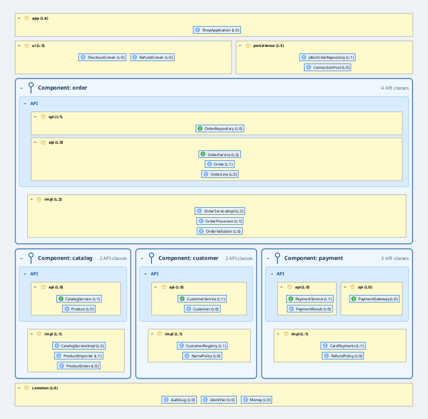
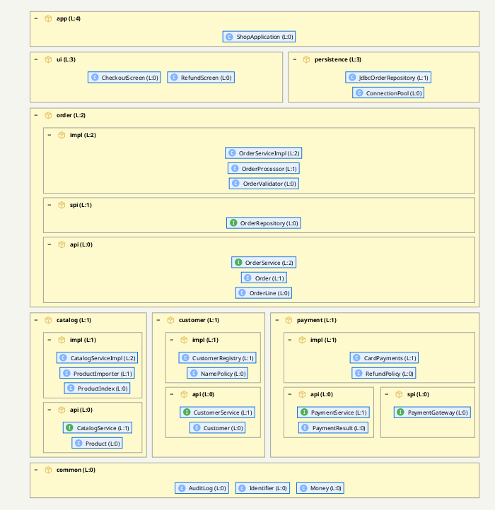
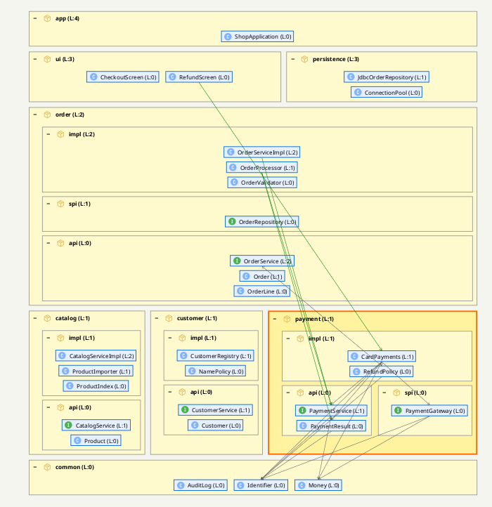
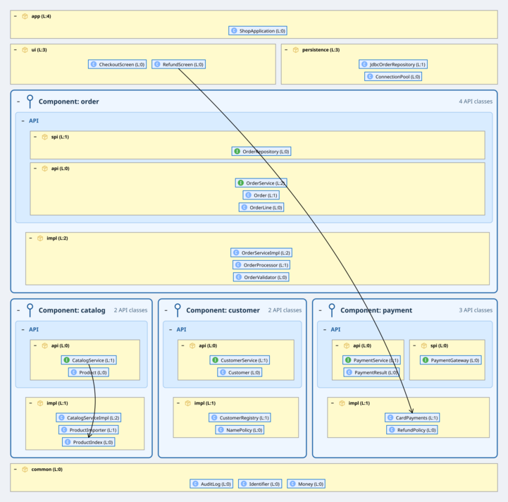
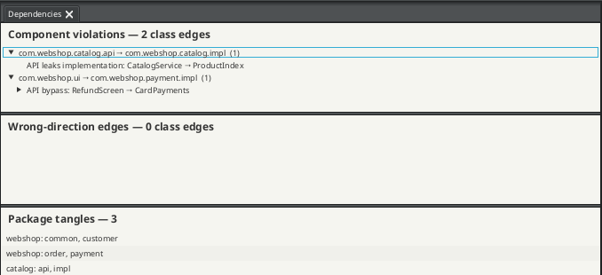
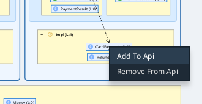
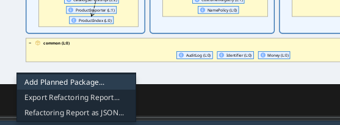
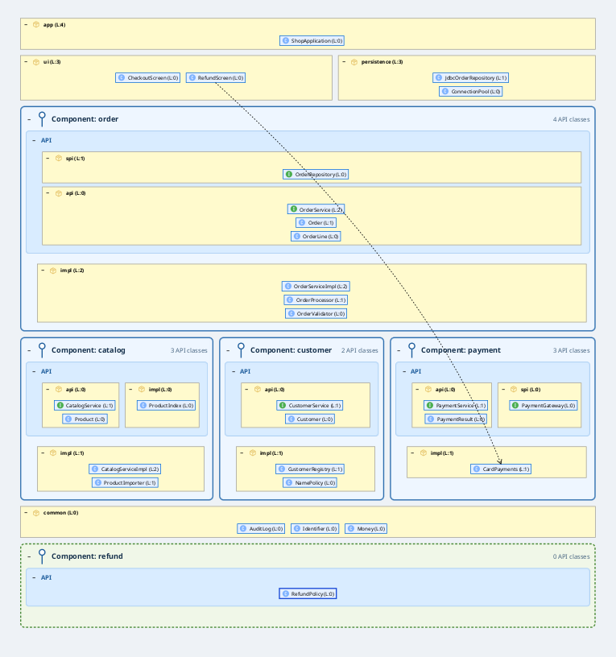

# Component View

[Handbook home](README.md) · [Concepts](concepts.md#components) ·
[Layered Architecture View](layered-view.md) · [Planning a refactoring](refactoring.md)

**View → Component View** shows the layers with the boundaries of components. A component has a
public part, its API, and a private part, its implementation. Between components and packages the
order is the usual one; within a component it is [inverted](#the-inverted-layers): the API is on top.

`order`, `catalog`, `customer` and `payment` are components because they have a sub-package `api`.
The API is the blue area at the top of each. `app`, `ui`, `persistence` and `common` are plain
packages.

## What is a component

The purpose of a component is to keep changes local: clients depend on what it promises, not on how
it keeps the promise. A layer says something else, in which direction dependencies run. A dependency
can run in the right direction and still bypass an API, as `RefundScreen` → `CardPayments` does.

- A package is a component if it has a direct sub-package named **`api`** (called by others) or
  **`spi`** (implemented by others).
- Everything below `api` and `spi` is public, everything else is private. It does not matter
  whether a type is an interface or how it is called.
- Components can contain components. An inner component belongs to the private part of the outer
  one, and whoever enters several components has to use the API of each.
- Nothing nests inside `api` and `spi`; they are public as a whole.

Declarations complement the rule or override it. The first one that applies decides:

| | Declaration | Where |
| --- | --- | --- |
| 1 | The marks **Add To Api** and **Remove From Api** | [in this view](#marking-the-api) |
| 2 | `exports` of a Java module | `module-info.java` |
| 3 | `@S202Api` on a package | `package-info.java` |
| 4 | The names `api` and `spi` | the package |

`@S202Api` makes a package with its sub-packages public. On the root package of a component it
makes the classes of exactly this package public, for components that keep their API at the root
and hide the rest in `impl`. `@S202Component` declares a component without `api` or `spi`, and
`@S202Package` keeps a package from becoming one. The annotations are in the module
[s202-annotations](../../s202-annotations), which has no dependencies and is not needed at run time.

## The inverted layers

The implementation depends on the API: it implements its interfaces and uses its types. In the
[Layered Architecture View](layered-view.md) the API is therefore at the bottom of its package, on
level 0 or 1, and the implementation above it:

The Component View turns this round. The API is drawn on top, as the interface to everybody who uses
the component from above, and the implementation below, hidden behind it. Only these two parts
change places; inside the API and inside the implementation the layers are as usual.

So the dependencies of an implementation on its own API run **upwards** here. That is a matter of the
drawing and no violation; the numbers still tell the order, `api` with `L:0` above `impl` with `L:2`.
What runs down, from the API into the implementation, is the dependency that is wrong, the
[API leak](#violations).

The two views do not contradict each other. A valid component architecture without cycles has no
violations in the Layered Architecture View either: whoever uses an API from outside lies above it, and
so does the implementation. It only looks unstructured there. All arrows from outside pass the upper
rows of a component and end at the bottom, on level 0 or 1, as if they went through the implementation:

The green arrows of `order` run across `impl` to `api`. With the API on top the same arrows end at the
upper edge of the component, and one that goes on into the implementation stands out.

The boundary alone does not prevent cycles: `RefundPolicy` uses `order` through its API, which is
right here, and is still a violation of the layers, because `order` uses `payment` as well. So look
at both views.

The inverted layers show *inversion of control*. A call goes from top to bottom: `RefundScreen` calls
`OrderService`, and `OrderServiceImpl` is executed. The dependency in the code points the other way,
from the implementation to the API. That is why the implementation can be replaced and the caller does
not notice. `spi` does the same at the other end: `order` calls `OrderRepository`, and
`JdbcOrderRepository` in `persistence`, which lies above, is executed. `persistence` depends on
`order`, not `order` on the database.

## Violations

**Show Violations** draws what breaks the boundaries.

| Violation | Meaning | In the picture |
| --- | --- | --- |
| API bypass | Code outside a component uses one of its private classes. | `RefundScreen` → `CardPayments` |
| API leaks implementation | A public class depends on a private one, so that whoever uses the API depends on the implementation as well. | `CatalogService` → `ProductIndex` |

The second arrow is dashed because it is a [back-edge](concepts.md#violations) as well, the first
one is dotted. Dependencies against the layers are not violations in this view; look at them in the
[Layered Architecture View](layered-view.md#violations).

The panel [Dependencies](window.md#dependencies) lists them under *Component violations*:

## Marking the API

Right-click on a class or package:

| Entry | Effect |
| --- | --- |
| Add To Api | The element becomes public in its component. |
| Remove From Api | It becomes private. |

The same is done by dragging an element from the implementation of its component into the blue
area, or the other way. A mark belongs to the innermost component around the element; marking an
inner component makes it public in the outer one. **Add To Api** outside of any component makes one:
that is how a system without `api` packages can be explored.

Marks are kept with the analysis and stored in the project file. The
[violation report](refactoring.md#violation-report) takes them into account.

## Moving and planning

A class or package that is dragged to another package or component is
[moved](layered-view.md#moving-boxes), as a plan. It belongs to the component it was dropped into,
public in the blue area and private elsewhere, and the component violations follow at once.

For a component that does not exist yet, right-click on the background:

| Entry | Effect |
| --- | --- |
| Add Planned Package... | Asks for a name and adds an empty component at the bottom, with a green dashed frame. Its menu has **Rename Package...** and **Delete Package**. |
| Export Refactoring Report... | Writes the [refactoring report](refactoring.md#refactoring-report). |
| Refactoring Report as JSON... | Shows the changes of this view as [JSON](refactoring.md#json), to copy. |

In the picture `refund` was planned and `RefundPolicy` dragged into its API, and `ProductIndex`
was added to the API of `catalog`. Of the two violations the API bypass is left: a public
`ProductIndex` is no leak any more. Whether that is a good idea is another question; returning a
type of the API would be better.

Planned packages and moves are not stored in the project file.

## Use cases

- **A system with components.** Check that nobody goes around an API. A view without violations is
  a good starting point for Java modules.
- **A system without components.** Mark what others are meant to use, look at what is left over,
  and decide whether the boundary is worth it, before anything is changed.

[Next: Hexagonal View →](hexagonal-view.md)
