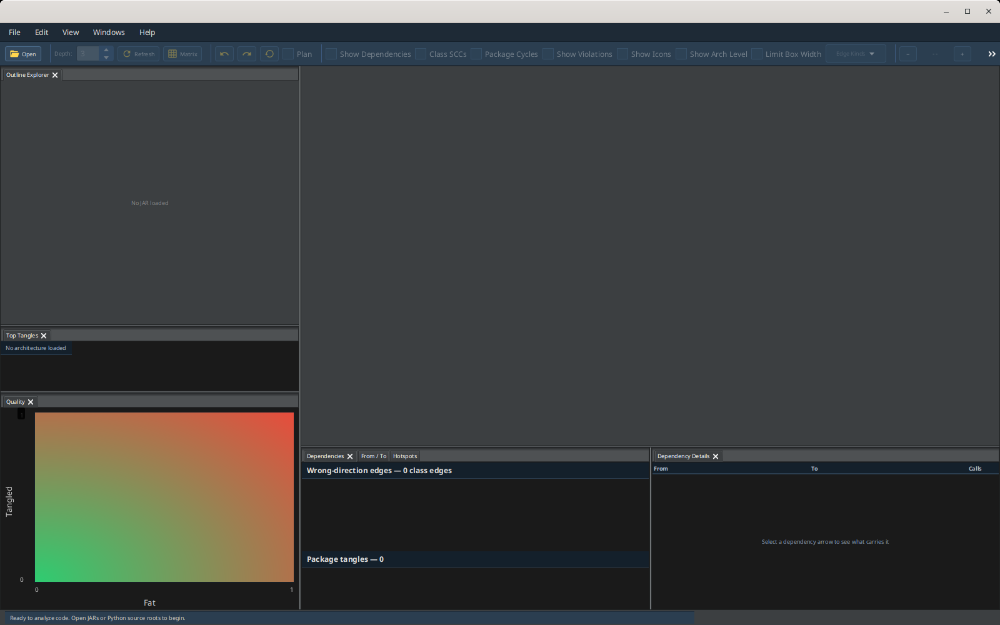
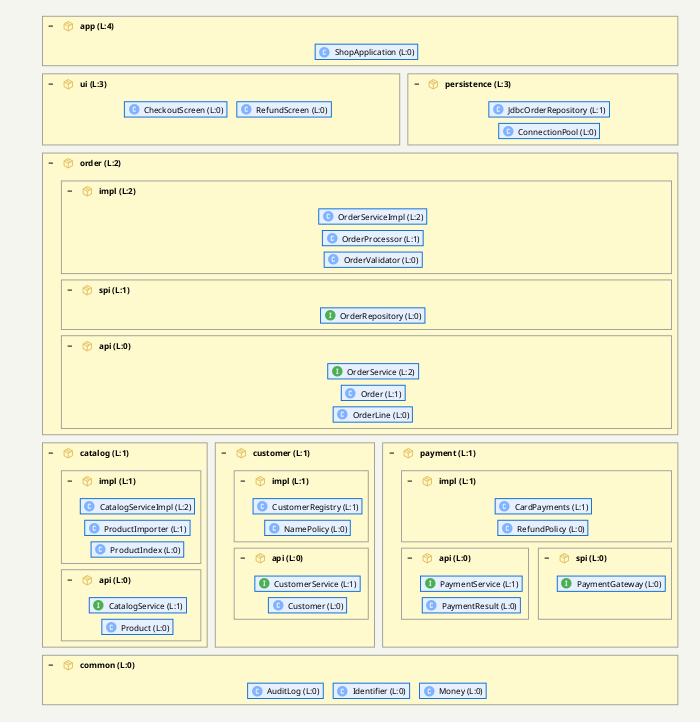
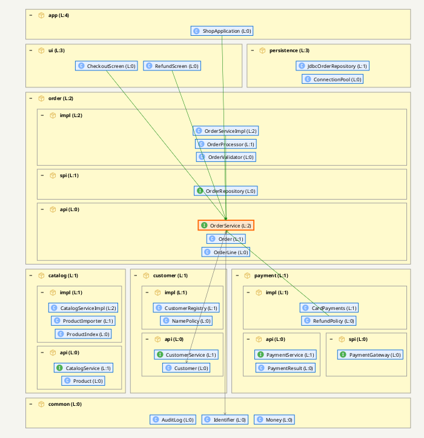
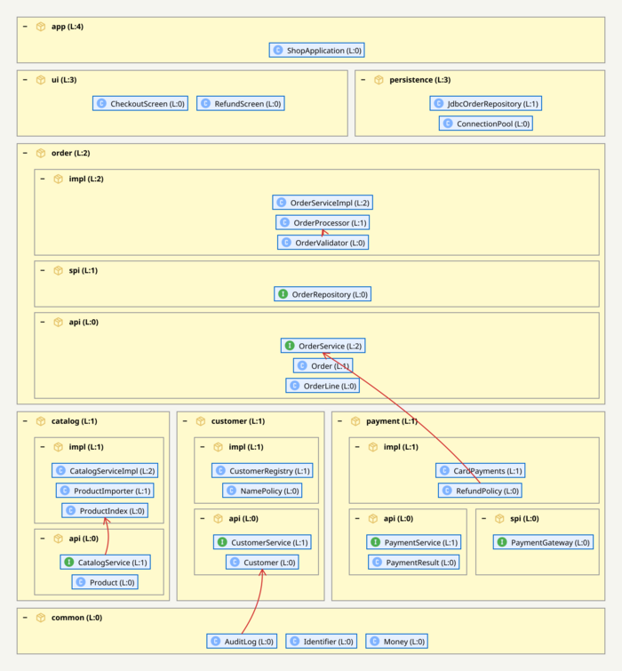
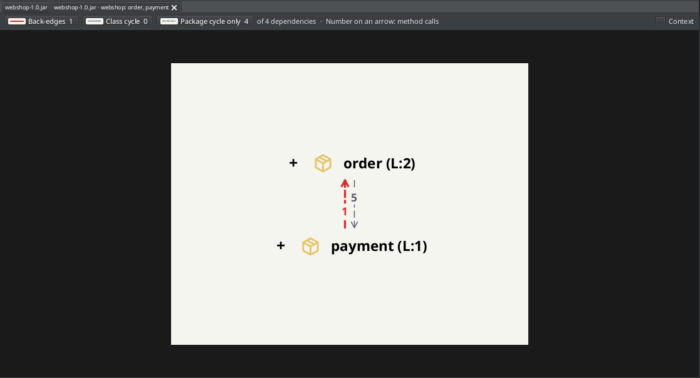
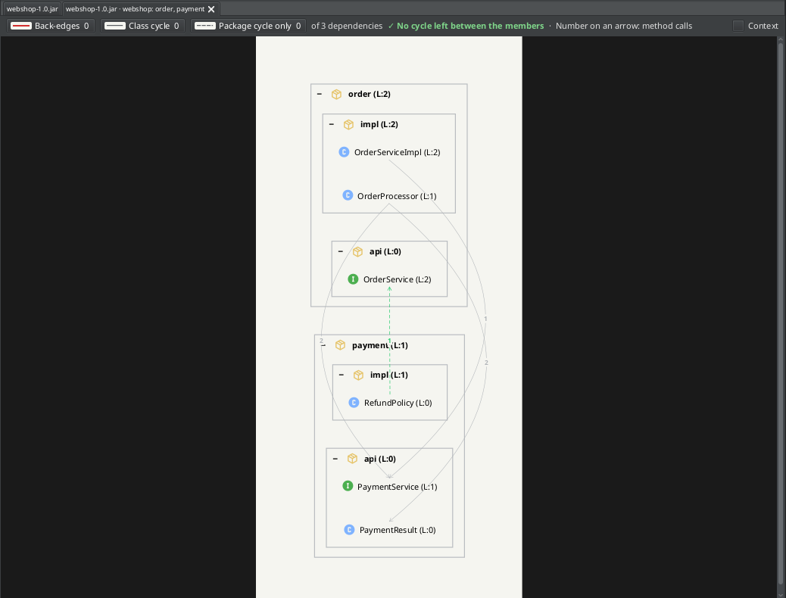

# Getting Started

[Handbook home](README.md) · [Concepts](concepts.md) · [The web shop story](webshop-story.md) ·
[Loading code](loading-code.md) · [The window](window.md)

## Install a release

Download a release from the [release page](https://github.com/Weigend/S202/releases) and unpack
it. It brings its own Java runtime, so nothing has to be installed first.

| System | File | Start |
| --- | --- | --- |
| Linux x64 | `S202-<version>-linux-x64.tar.gz` | `S202/bin/S202` |
| Windows x64 | `S202-<version>-windows-x64.zip` | `S202\S202.exe` |
| macOS, Apple Silicon | `S202-<version>-macos-arm64.zip` | `S202.app` |

The programs are not signed with a vendor certificate:

- **macOS** refuses a downloaded app it cannot verify. Remove the download mark once, then open
  the app as usual: `xattr -dr com.apple.quarantine S202.app`
- **Windows** may show *Windows protected your PC*. Choose **More info**, then **Run anyway**.

Reading Python needs `python3` on the machine, reading Go needs `go`. Java, JavaScript and C need
nothing else.

## Run from this repository

Java 25 or newer, Maven 3.9 or newer and git are needed. The first build also fetches and builds
the window platform WFX, which is not on Maven Central.

```bash
./build-all.sh        # once: WFX, S202 and, with Node.js 18+, the City3D bundle
./run-ui.sh           # start, or with files to open: ./run-ui.sh my.jar
```

On Windows these are `build-all.bat` and `run-ui.bat`. Without Node.js everything works except
**File → Show City3D View**.

## The first analysis

Any JAR of your own will do. To follow the pictures, build the
[sample project](README.md#the-sample-project) first.



**1. Open the code.** Press **Open** in the toolbar, or choose **File → Open JAR...**, and select
`webshop-1.0.jar`. The status bar shows the progress and ends with

```text
Loaded 1 JAR(s) | 29 classes | 5 levels | Max level 4 | invariants OK
```

**2. Look at the layers.** A tab with the name of the JAR shows the packages in rows. `common` is
at the bottom because everything uses it; `app` is at the top because nothing uses it. The
packages `com` and `webshop` are left out: they contain nothing else and would only be frames.



**3. Ask who uses what.** Switch on **Show Dependencies**. All arrows at once are rarely
readable, so click a class, for example `OrderService` in `order.api`. Now only its dependencies
are drawn: grey what it uses, green what uses it. Click the class again before you go on; that
shows everything again.



**4. Ask what breaks the order.** Switch **Show Dependencies** off and **Show Violations** on. Four
dashed arrows remain. They are the dependencies that run against the layers.



The panel **Dependencies** at the bottom lists the same four, and below them the three package
tangles. These black arrows cannot be clicked; a double-click on an entry of the panel opens it
in a tab of its own.

**5. Look at a cycle.** Double-click `webshop: order, payment` in the panel **Top Tangles**. A tab
opens that shows nothing but this tangle: `order` uses `payment` with five calls, `payment` uses
`order` with one.



**6. Find the code behind it.** Click the red arrow. The panel **Dependency Details** lists what
carries it: `RefundPolicy.allows` calls `OrderService.isCancelled`. Open `order` and its `api`, and
`payment` and its `impl`, with their **+** to see the two classes.

**7. Try a remedy.** Right-click the arrow between `RefundPolicy` and `OrderService` and choose
**Cut**. The bar above the picture says *No cycle left between the members*. Nothing has been
changed; the cut is noted as a planned refactoring.



**8. Take it with you.** **File → Export Refactoring Report...** writes what you planned as a
text, **File → Export Violations...** everything S202 found, and **File → Export Image...** the
picture.

## Where to go from here

- What the findings mean and how to judge them: [The web shop story](webshop-story.md)
- What else the pictures show and how to filter them: [Layered Architecture View](layered-view.md)
- Larger systems: [Scopes](layered-view.md#scopes), [Package depth](layered-view.md#package-depth)
  and [Limit Box Width](layered-view.md#box-width)
- The other four defects of the sample: [Tangles](tangle-view.md) and
  [Component View](component-view.md)

[Next: The web shop story →](webshop-story.md)
