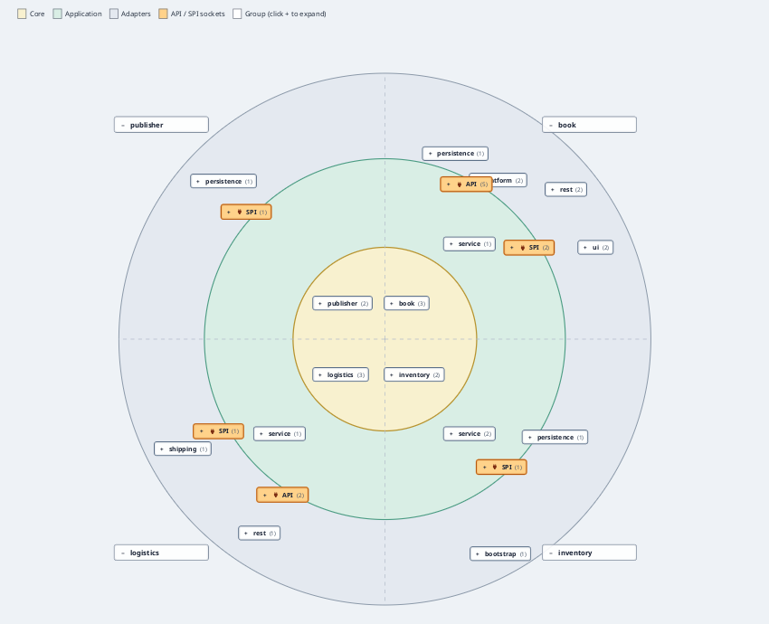
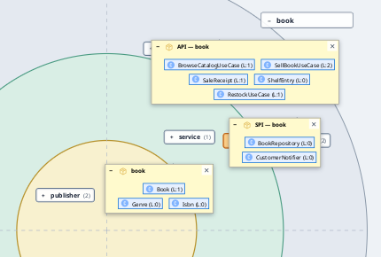
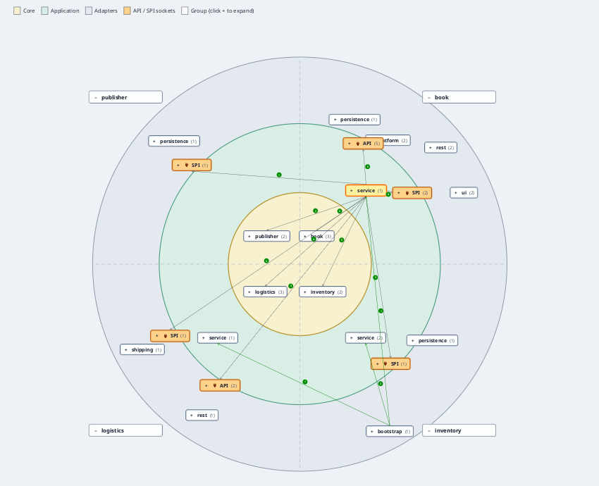
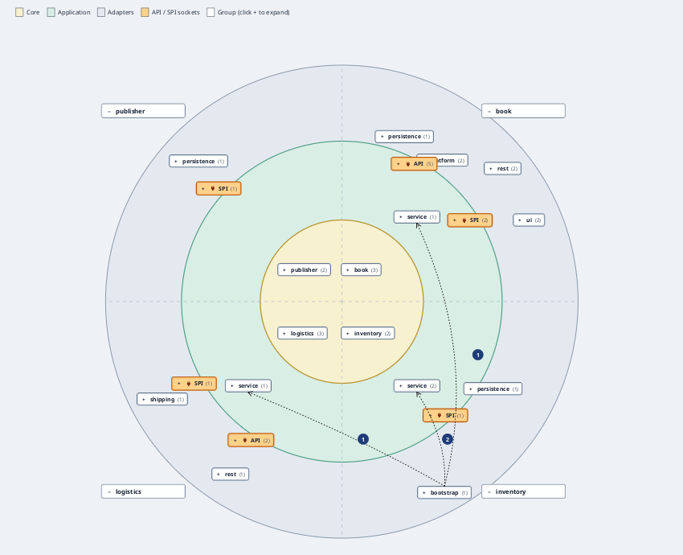
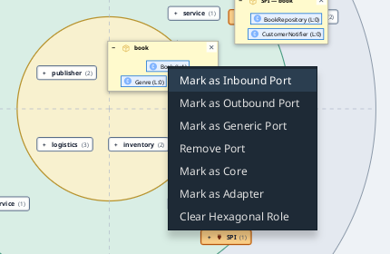

# Hexagonal View

[Handbook home](README.md) · [Component View](component-view.md) ·
[Layered Architecture View](layered-view.md) · [Reference](reference.md)

> **Proof of concept.** This view explores another arrangement of the same dependencies. Layout
> and rules may change.

**View → Hexagonal View** arranges packages as the rings of a hexagonal architecture, also called
*ports and adapters*: the core in the middle, the application around it, the adapters outside.



The pictures show the project [test-hexagon](../../test-hexagon), a bookshop. It is built in the
root of the repository:

```bash
mvn -pl test-hexagon -am package   # produces test-hexagon/target/test-hexagon-1.5.0.jar
```

## Reading the picture

| Element | Meaning |
| --- | --- |
| Yellow ring, *Core* | The business packages everything else stands on. |
| Green ring, *Application* | The use cases. |
| Grey ring, *Adapters* | User interface, persistence, interfaces to other systems. |
| Sector with its name outside | A business theme: a package of the core. Every class of the other rings is put into the theme it depends on most. |
| White box | The classes of one package that belong to the theme; the number counts them. A package can have a box in several sectors. |
| Orange box | The ports of the theme on the edge of the application: **API** is called from outside, **SPI** is implemented outside. |

**−** at the name of a theme hides its boxes. **+** in a box opens a card with its classes; the
cross closes it.



A click on a box selects its package. With **Show Dependencies** only the dependencies of this
package are drawn, also those of its boxes in other sectors: below, the package `service`, selected
in the theme `book`.



## How the rings are found

For every package with classes, the first rule that applies decides:

1. a role set by hand, see [below](#roles-and-ports);
2. its relation to the packages named `api` and `spi`: a package that implements an `spi` is an
   adapter, one that implements an `api` is application, one that only uses an `api` is an adapter;
3. its global level compared with the highest one: the lower third is core, the middle third
   application, the rest adapters.

The themes are the largest group of core packages with a common parent, here the packages in
`domain`. If there is no such group, the top-level packages or components take their place.

## Violations

| Violation | Meaning |
| --- | --- |
| Outward dependency | A class depends on one of a ring further out. |
| Port bypass | An adapter uses a class of the application ring that is not a port. |

A port is a class in a package named `api` or `spi`, or one [marked by hand](#roles-and-ports).

Violations are drawn with **Show Violations** and listed under *Hexagonal violations* in the panel
[Dependencies](window.md#dependencies).



The bookshop has four: `bootstrap`, the composition root that puts the application together, creates
the services instead of using them through their ports. That is its task, so they can be accepted.

## Roles and ports

Right-click on a class in a card:



| Entry | Effect |
| --- | --- |
| Mark as Inbound Port | The class is a port that is called from outside. It moves to the **API** of the theme. |
| Mark as Outbound Port | The class is a port that is implemented outside. It moves to the **SPI**. |
| Mark as Generic Port | A port without a direction; it is shown with the **API**. |
| Remove Port | Takes the mark back. |
| Mark as Core, Mark as Adapter | Puts the class into this ring. |
| Clear Hexagonal Role | Takes the role back. |

A box of a package has **Mark Package as Core**, **Mark Package as Adapter** and **Clear Package
Role**, the name of a theme the same for the *Segment*.

Marked ports have an orange frame in the card. Roles and ports are kept with the analysis, stored
in the project file and listed in the [refactoring report](refactoring.md#refactoring-report).

[Next: 3D views →](3d-views.md)
