# Layered Architecture View

[Handbook home](README.md) · [Concepts](concepts.md) · [The window](window.md) ·
[Tangles](tangle-view.md) · [Component View](component-view.md)

This is the view an analysis opens with. It shows packages and classes as boxes within boxes, in
rows: what is used lies below what uses it. Why that is so, and what the numbers `L:n` and `G:n`
mean, is said in [Concepts](concepts.md#levels-and-layers).

The rows are computed from the dependencies that exist. They are not the layers somebody once
intended; see [three different architectures](why-architecture.md#three-different-architectures).

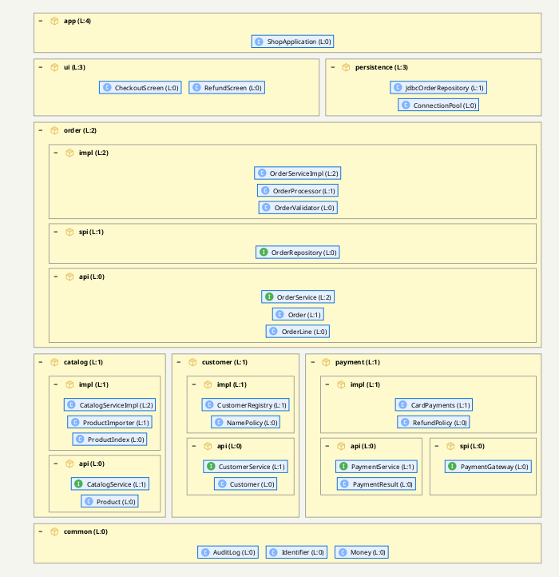

Reading the picture from the top: `app` starts the shop. Below are `ui` and `persistence`, which
are in the same row because they do not know each other. Both use `order`, which uses `catalog`,
`customer` and `payment`, and everything stands on `common`. Inside `order` the same rule holds
again: `impl` is above `spi`, and `spi` above `api`.

Packages at the top that contain nothing but one other package, here `com` and `webshop`, are not
drawn.

## Moving around

| Action | Effect |
| --- | --- |
| **−** or **+** in a package | Closes or opens it. |
| Click on a class or package | Selects it; another click lifts the selection. |
| Ctrl+F, **Edit → Find Class or Package...** | [Finds](#finding-a-class-or-package) it by name and brings it into the picture. |
| Ctrl and mouse wheel, **−** and **+** in the toolbar | Zoom, from 2 % to 300 %. |
| **1:1** | Zoom 100 %. |
| **Fit** | Zooms so that the whole picture fits into the window, as large as possible. |
| Dragging the background | Moves the picture. |
| Dragging a class or package | [Moves the box](#moving-boxes), as a plan. |
| Mouse over a class or a closed package | Its [arrows](#dependencies) stand out. |
| Click on an arrow, a violation or the line of a cycle | Selects it and fills [Dependency Details](window.md#dependency-details). |
| Right-click on a line between two classes | [Cut or Restore](tangle-view.md#cutting). |
| Right-click on a class or package | **Open Scope**, what it [depends on](window.md#from--to) or is used by, and [marks](#transitive-users-and-dependencies) for what it reaches. |

Lines are drawn over the boxes, and a click on a place where one runs selects the line. If that
happens instead of selecting a class, click its edge or select it in the outline. The arrows of
**Show Dependencies** are thin: zoom in to hit one. One line is selected at a time, whichever kind
it is.

### Finding a class or package

Ctrl+F opens a field at the top of the picture. While you type, it lists the classes and packages
of the view whose name fits: the name itself first, then names that start with what you typed,
then CamelCase initials (`PS` finds `PaymentService`), then names that contain it. With a dot in
it, the full name counts as well: `payment.api` finds the package.

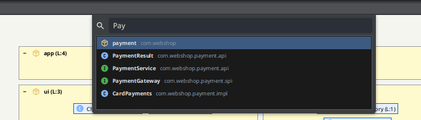

The arrow keys choose a hit, Enter or a click takes it: the packages around it open, it is selected
as if you had clicked it, and the picture scrolls it into the middle. The panels follow the
selection. Escape or a click elsewhere puts the field away. Only what the tab shows is found: in a
[scope](#scopes), the classes of the scope.

### Package depth

**Depth** says how many levels of packages are open after the picture was built: 3 at first, 0
closes everything, 10 is the most. A new value is applied with **Refresh**. Zoom, position and
[moves](#moving-boxes) stay.

### Box width

The boxes of a row share its width, so that they end flush. In a large system a wide package
stretches all the others. **Limit Box Width** keeps boxes to the width they need. The picture
shows S202 itself, without and with it:

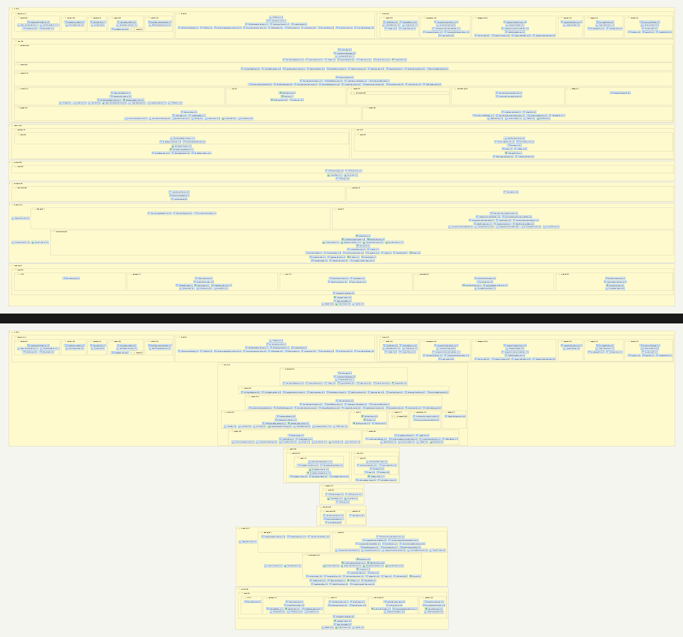

### Global levels

**Show Arch Level** adds the global level `G:n` to every box. It tells what the rows cannot: that
`RefundScreen` with `G:7` stands on a longer chain of dependencies than `CheckoutScreen` with
`G:5`, although both are in the same row.

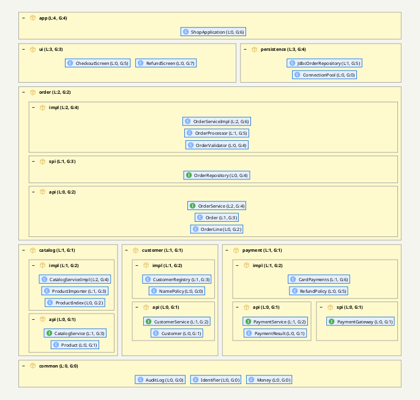

## Dependencies

**Show Dependencies** draws an arrow from every class to the classes it uses.

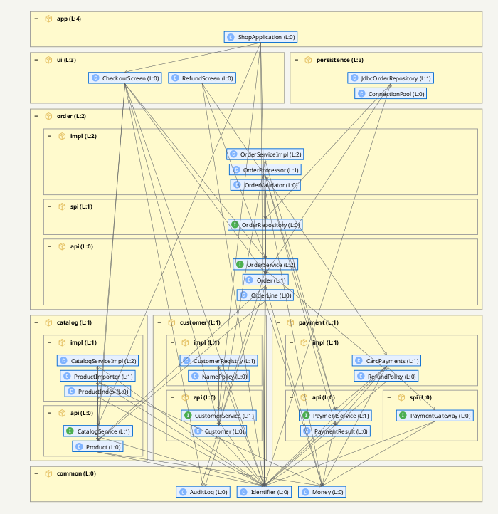

That is the answer to *how entangled is this*, and to where the dependencies go: a class nobody
points to may be dead, one that many point to is a foundation, one that points everywhere knows too
much. Three things make it readable; where they do not suffice, the [matrix](matrix-view.md) shows
the same dependencies without lines.

**Pointing.** The arrows of the class or closed package under the mouse get thicker, dark what it
uses, green what uses it, and the boxes at their other ends turn green. The other arrows step back,
but stay.

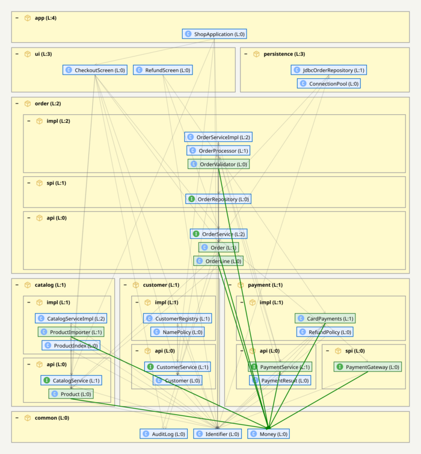

**Selecting.** With a class or package selected, only its dependencies are drawn: grey what it
uses, green what uses it. Below, the package `payment` is selected. One of the grey arrows leads
up to `OrderService`, which is the violation.

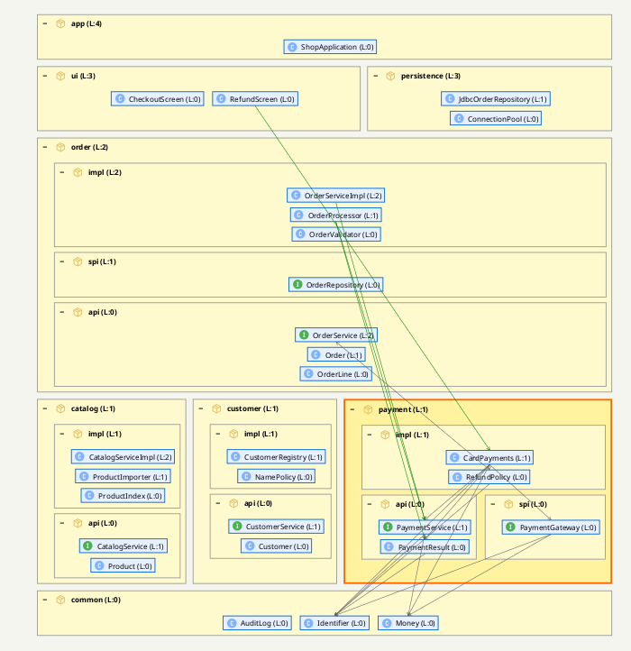

**Closing packages.** An arrow of a closed package stands for all dependencies of its classes. The
number in the circle counts them. A green circle means that all of them run down, a red one
that at least one runs up; `5 / 2↑` means five, of which two run up.

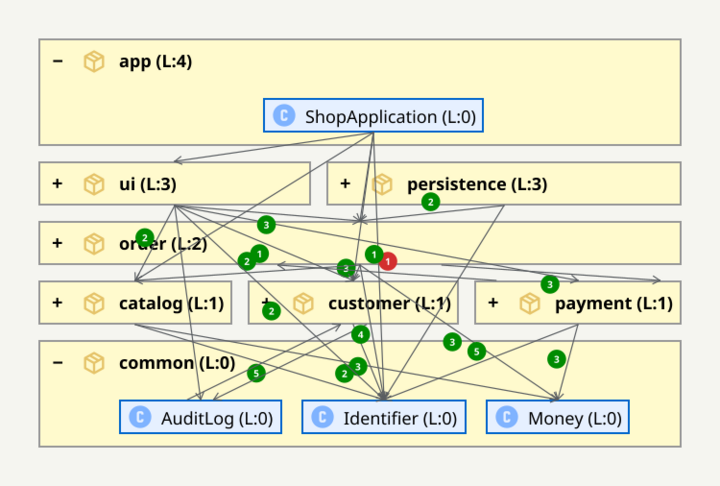

In the picture the red `1` is the dependency of `payment` on `order`.

### Transitive users and dependencies

An arrow shows one step. Whether a class can be taken out, or what a change to it reaches, depends
on all the steps behind it. Right-click on a class or package:

| Entry | Effect |
| --- | --- |
| **Mark Transitive Users** | Marks every class that uses it, directly or through other classes. |
| **Mark Transitive Dependencies** | Marks every class it uses, directly or through other classes. |
| **Clear Marks** | Removes the marks. |

The marked classes turn turquoise, the packages around them get a turquoise frame, and a closed
package turns turquoise as a whole when it holds one. What you started from is selected. For a
package, everything in it is the start: its users are the classes outside it that reach it.

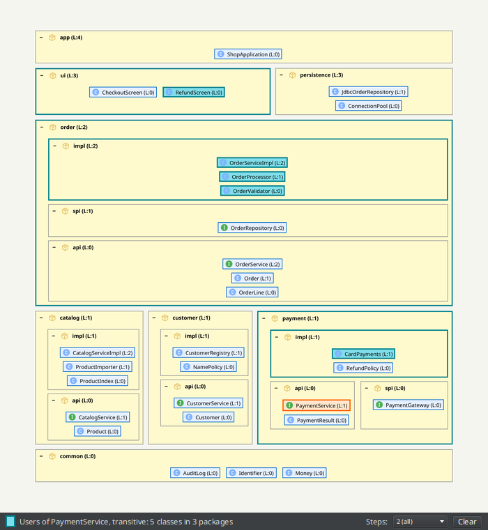

Above, everything that uses `PaymentService`: `CardPayments` implements it, `OrderProcessor` and
`OrderServiceImpl` use it. `OrderValidator` reaches it through `OrderProcessor`, and
`RefundScreen` through `CardPayments`, past the API of `payment`. The strip below the picture
counts the classes and packages. **Steps** limits how far the marks go: 1 is only the direct users,
the last entry is all of them. **Clear** removes the marks.

The way leads through the whole analysis, also through classes the tab does not show; in a scope,
the strip counts the classes outside it, which cannot be marked. Every kind of dependency counts,
also one that [Edge Kinds](#edge-kinds) does not draw. With the [plan](refactoring.md) switched on,
a planned cut takes its dependency away, and the marks follow.

### Edge kinds

**Edge Kinds** chooses what is drawn:

| Kind | Contains |
| --- | --- |
| Calls | method calls and created instances |
| Inheritance | `extends`, `implements`, inheritance of nested classes |
| Imports | imports of languages read from source |
| References | every other mention of a type |

A dependency disappears when everything it consists of is hidden. Here *Calls* and *References*
are switched off, and what remains is who implements which interface. The button says how many
kinds are shown.

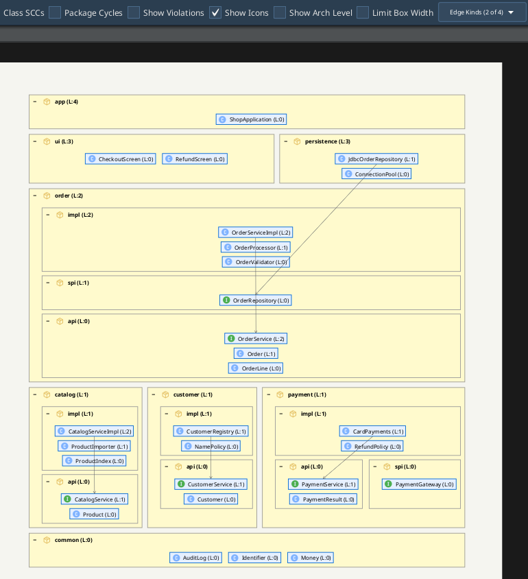

The filter belongs to the tab and applies to all its arrows, violations and cycles included. A
hidden dependency still counts for levels, cycles, violations and all numbers.

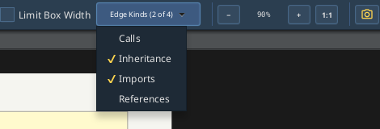

Here *Inheritance* and *Imports* are chosen.

## Violations

**Show Violations** draws the dependencies that run against the layers in red, also when the other
arrows are off.

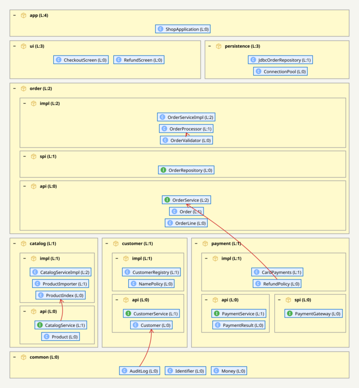

These four are the [back-edges](concepts.md#violations) of the four cycles:

| Arrow | Means |
| --- | --- |
| `RefundPolicy` → `OrderService` | `payment` uses `order`, which uses `payment`. |
| `AuditLog` → `Customer` | The foundation knows a business class. |
| `CatalogService` → `ProductIndex` | An interface depends on its implementation. |
| `OrderValidator` → `OrderProcessor` | Two classes call each other. |

The fifth defect of the sample, `RefundScreen` → `CardPayments`, is not among them: it runs
downwards, which is right for layers. It breaks the boundary of a component and is found in the
[Component View](component-view.md#violations).

If an end of the arrow is in a closed package, the arrow leads to the package, and a circle counts
the dependencies. If both ends are in the same closed package, it is a loop above it. A solid arrow
is a back-edge of the code, a dotted one comes from a move.

## Cycles

**Class SCCs** draws the dependencies that lie on a class cycle in purple, **Package Cycles** those of
a package cycle in orange and dashed. With both on, a dependency that is purple is not drawn in orange
as well; with Package Cycles alone, a class cycle between two packages is orange too. (SCC is the term of graph
theory: *strongly connected component*.)

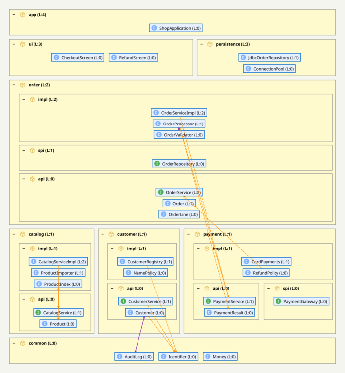

Two class cycles are purple, `OrderProcessor` ↔ `OrderValidator` and `Customer` ↔ `AuditLog`. The
orange lines are the three package cycles: `order` with `payment`, `catalog.api` with
`catalog.impl`, and `common` with `customer`. Between `common` and `customer` both colours meet:
the purple line is the reason, the orange ones only make the cycle heavier.

If a class is in a closed package, the line leads to the package, and a circle counts the
dependencies if there are several. Such a line is purple if one of them lies on a class cycle. Cycles
within a closed package are a loop at its upper right corner. The status bar says how many there are. What to do with a cycle is the subject of [Tangles](tangle-view.md).

## Scopes

A large system is easier to understand in pieces. **Open Scope** in the menu of a package, in the
picture or in the [outline](window.md#outline-explorer), opens a tab with this package alone. It is a full layered
view, with all switches and panels of its own.

More can be added: right-click into the picture, choose **Add to Scope...** and select a package
or class. The field at the top filters the list; a double-click adds.

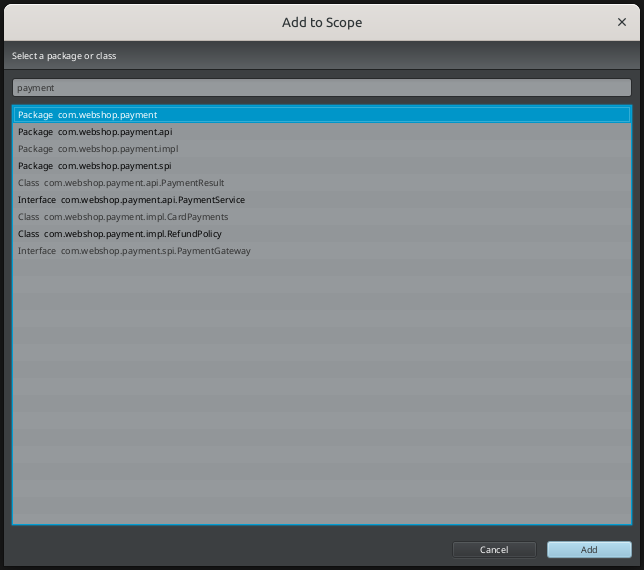

Here `payment` was added to the scope of `order`. Only dependencies between what is shown are
drawn.

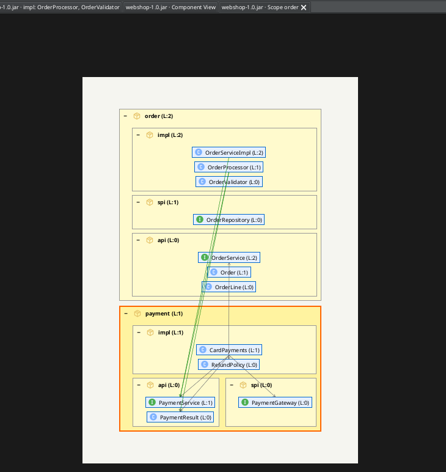

A Component or Hexagonal View that is opened from a scope tab shows this scope as well.

## Moving boxes

What would be better if this class were there? Drag it there. The move is a plan in this tab; the
code is not changed.

While dragging, a blue bar shows where the box would be put: a vertical one beside other boxes of a
row, a horizontal one in a row of its own.

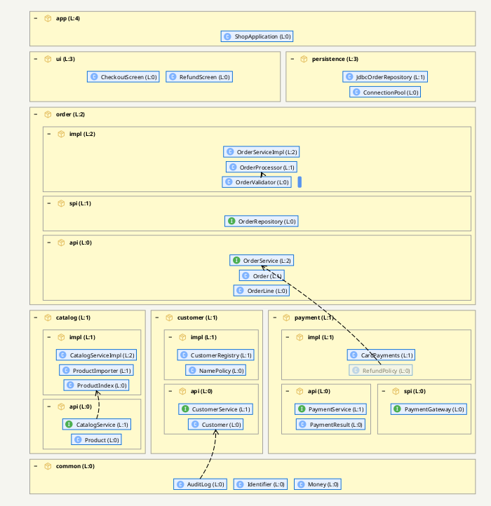

After the drop the box has a dark blue frame, the status bar names the move, and the violations are
computed anew. The first attempt to resolve the cycle of `order` and `payment` was to move
`RefundPolicy` to `order.impl`, because it only asks `order`:

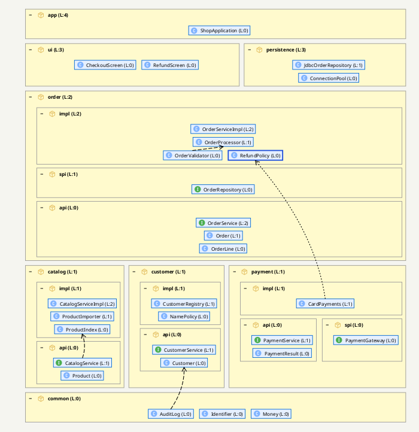

It does not work. The old violation is gone, but `CardPayments` uses `RefundPolicy`, and that
dependency now runs up. It is dotted because it is not a back-edge of the analyzed code. The cycle
is not a matter of the place of a class.

The other cycle is. `AuditLog` is moved from `common` to `customer.api`, beside `Customer`:

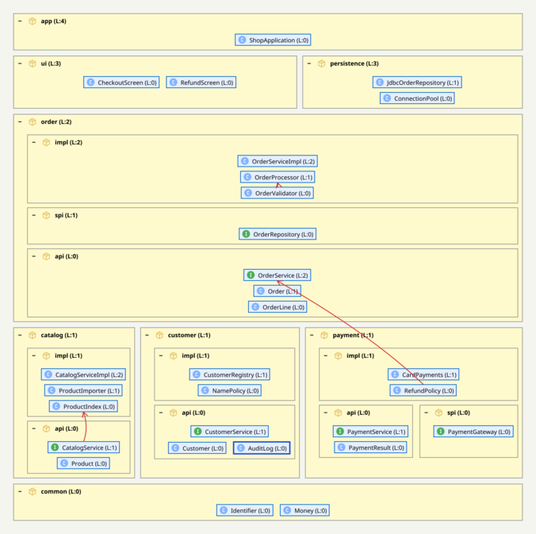

The violation is gone, and the panel [Dependencies](window.md#dependencies) counts three
wrong-direction edges instead of four and two package tangles instead of three. The two classes
still use each other, but within one package, where they can stay in one row.

| Action | Effect |
| --- | --- |
| Ctrl+Z, **Edit → Undo** | Takes the last move back. Zoom and open packages stay. |
| Ctrl+Shift+Z, **Edit → Redo** | Makes it again. |
| **Edit → Discard Moves of This View** | Discards all moves of the tab. |
| **Edit → Reset Refactorings...** | Discards everything planned in the analysis. |
| **Plan** in the toolbar | [Off](refactoring.md#the-code-and-the-plan): shows the code as it was analyzed. The moves are kept. |

Moves are listed in the [refactoring report](refactoring.md#refactoring-report) and stored in the
[project file](projects-and-export.md#project-files). All panels follow them.

[Next: Dependency matrix →](matrix-view.md)
