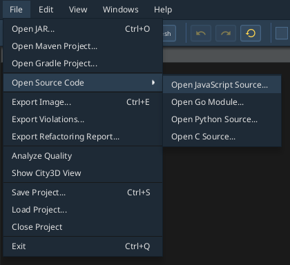
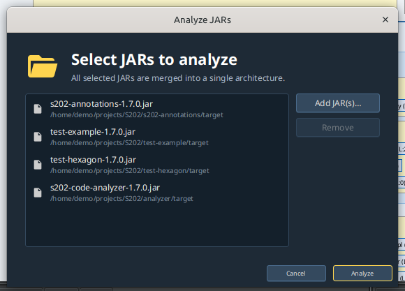
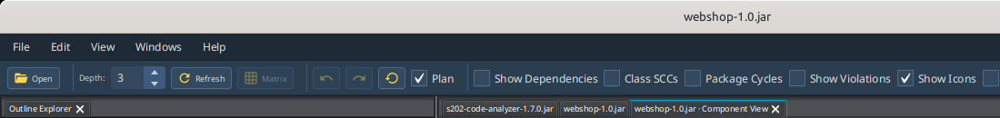

# Loading Code

[Handbook home](README.md) · [Getting started](getting-started.md) · [The window](window.md) ·
[Reference](reference.md)

Code is opened with the **File** menu. Every opened code becomes an **analysis** in a tab of its
own; the analyses already open stay.



| Entry | Select | What is read | Status |
| --- | --- | --- | --- |
| Open JAR... | one or more JAR files | Java bytecode | Stable |
| Open Maven Project... | the `pom.xml` of the root | the JARs in `target/` of all modules | Stable |
| Open Gradle Project... | `settings.gradle(.kts)` or `build.gradle(.kts)` | the JARs in `build/libs/` of all subprojects | Beta |
| Open Source Code → Open JavaScript Source... | a project or source directory | ES modules | not rated |
| Open Source Code → Open Go Module... | the directory with `go.mod` | Go source | Alpha |
| Open Source Code → Open Python Source... | a project root or package directory | Python source | Alpha |
| Open Source Code → Open C Source... | a project or source directory | C source | PoC |

Files can also be named when S202 is started, such as `S202/bin/S202 my.jar`: JARs, or one `pom.xml`
or Gradle script.

The button **Open** in the toolbar takes JARs, a `pom.xml` and Gradle scripts in one dialog. Choose
either one project file or any number of JARs; a mixture is refused.

## Java

Java is read from compiled code. Kotlin and other JVM languages are read as well, as far as their
bytecode looks like that of Java.

### Several JARs

When more than one JAR is selected, a dialog shows them before the analysis starts. All of them
are merged into one architecture.



| Control | Effect |
| --- | --- |
| Add JAR(s)... | Adds JARs, also from other directories. |
| Remove | Takes the selected JAR out. |
| Analyze | Starts the analysis. |

### Maven and Gradle

S202 does not run the build. It looks for what the last build produced, so run `mvn package` or
`gradle build` first. The same dialog then shows the JARs that were found, and the status bar how
many modules had one:

```text
4 JAR(s) from 5/5 Maven module(s)
```

For Maven the modules of the `pom.xml` are followed recursively; modules with the packaging `pom`
have no JAR. JARs whose names end with `-sources`, `-javadoc`, `-tests` or `-test-sources` or
begin with `original-` are left out. For Gradle the `include` statements of the settings script
are read, and the directory of `:foo:bar` is taken to be `foo/bar`. Subprojects in other places
are not found; add their JARs with **Add JAR(s)...**.

### What is left out

The file `excluded-prefixes.txt` names the classes that do not belong to the analysis: the Java
library, JavaFX, test frameworks, generated code. A line is a prefix of the class name, or a
pattern with `*` and `?` for the whole name; `#` begins a comment.

```text
java.
org.junit.
*$Builder
```

The file is looked for in the working directory and its parent directories. If there is none, a
release uses the copy that comes with it; without any file only the classes of the JDK are left
out. It is read once, when the first code is analyzed: restart S202 after changing it.

Left out means: no box, no layer, no cycle. What the analyzed classes use of it is still recorded,
with the kind of use but without the methods called. [From / To](window.md#from--to), the
[matrix](matrix-view.md#libraries) and [Hotspots](window.md#hotspots) show it as *outside the
analysis*, as they do classes that are used but were not read at all. A class that is missing in
a package of the analysis is not counted as a library; that is mostly generated code.

Every class also remembers the JAR it was read from. [Hotspots](window.md#hotspots) lists the JARs
side by side, and the status bar names the JAR of a selected class.

## Source code

The readers for source code take a directory. Each file or type becomes a *class* and each
directory a *package* in the pictures.

| Language | Becomes a class | Needs | Not read |
| --- | --- | --- | --- |
| Python | a module, that is a file: `src/shop/orders/service.py` is `shop.orders.service` | `python3`, or the executable in the variable `PYTHON` or the property `s202.python.executable` | `.venv`, `venv`, `env`, `.tox`, caches, `site-packages`, `dist-packages`, `build`, `dist`, `.git` |
| Go | a type with its functions; functions without a type are collected per file | `go`, or the executable in the variable `GO` or the property `s202.go.executable` | `vendor`, `testdata`, `node_modules`, `.git` |
| JavaScript | an ES module, that is a `.js`, `.mjs` or `.cjs` file | nothing | `node_modules`, `dist`, `build`, `out`, `coverage`, `vendor`, minified files |
| C | a `.c` file | nothing | `bin`, `build`, `cmake-build-debug`, `cmake-build-release`, `lib`, `exe`, `doc`, `docs`, `target`, `.git` |

The directories `src` and `lib` of a Python project, `src`, `lib` and `app` of a JavaScript
project and `src` of a C project are recognized as source roots, so the project directory can be
selected as well. A Python package directory that is selected directly keeps its full name.

Only dependencies between parts of the opened code are recorded. Imports of libraries and dynamic
constructs (`getattr`, `importlib`, computed names) are skipped. In JavaScript and C the static
structure is read: imports and includes, classes, functions and direct calls.

The Python constructs and the kinds they become:

| Construct | Kind |
| --- | --- |
| `import pkg.mod`, `from .model import Order` | import |
| `class Service(BaseService)` | inheritance |
| type annotations, decorators | reference |
| direct calls, `Order(data)` | call |

## After loading

The status bar sums up what was read:

```text
Loaded 1 JAR(s) | 29 classes | 5 levels | Max level 4 | invariants OK
```

*Invariants* are rules S202 checks its own result against, for example that every dependency that
was not cut runs downwards. A finding is a bug in S202, not in your code. It opens the dialog
*Layout Invariants* with a text that can be copied into a bug report.

## Several analyses



The tabs of an analysis carry its name: `webshop-1.0.jar`, `webshop-1.0.jar · Component View`,
`webshop-1.0.jar · Scope order`. The title of the window names the analysis you are working on,
and all panels show that one. Opening the same code again gives `webshop-1.0.jar (2)`.

**File → Close Project** closes the analysis you are working on with all its tabs, **Windows →
Close All** closes every analysis. Neither asks first.

[Next: The window →](window.md)
