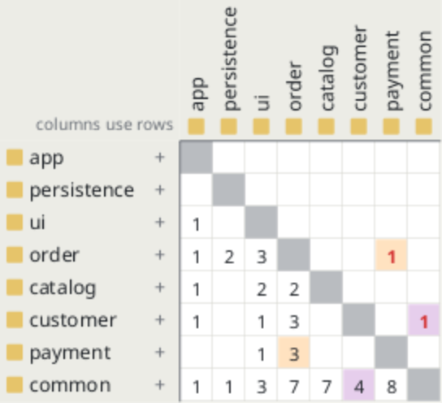
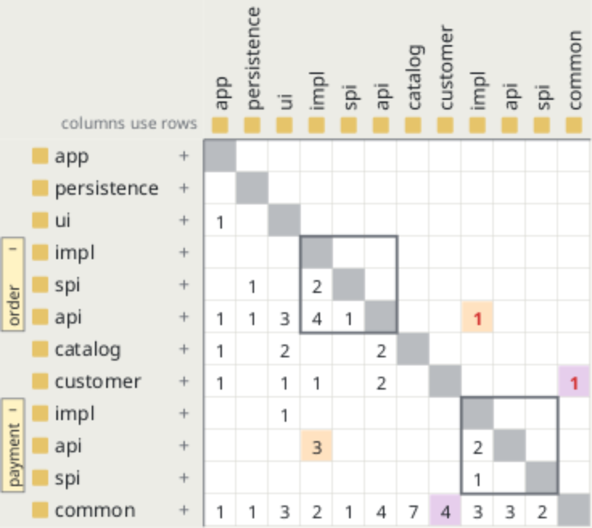
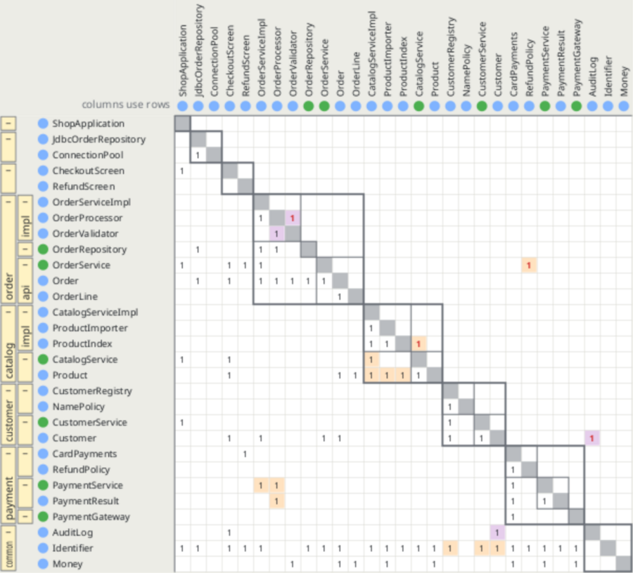
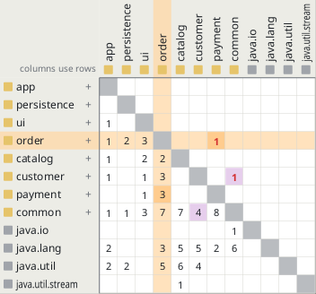

# Dependency Matrix

[Handbook home](README.md) · [Concepts](concepts.md) ·
[Layered Architecture View](layered-view.md) · [The window](window.md)

**Matrix** in the toolbar, or **View → Dependency Matrix**, opens the dependencies of the active tab
as a matrix, in a tab of its own. Layered, scope and tangle tabs have one. A matrix stays readable
where arrows do not, with many packages that use one another a lot; the picture says better where a
single class belongs.

Picture and matrix are two views of one thing: the same classes, filters, selection and plan. Drag
the tab of the matrix to the edge of the area to have both [side by side](window.md#tabs). What is
selected, moved or cut in one shows in the other, and the panels are the same for both. The matrix
closes with the tab it belongs to.

## Reading it

Rows and columns are the same elements in the same order. A number says how much the element of the
**column uses** of the element of the **row**: three dependencies lead from classes of `ui` to classes of `order`. The order is
that of the layers, the highest at the top left. So dependencies that run down are below the diagonal,
and what is above it runs against the layers.

| In the picture | Meaning |
| --- | --- |
| Number | How many class dependencies there are. With **Calls** on, how many calls carry them, where a dependency without calls counts 1. |
| Red and bold | At least one runs against the layers. |
| Purple ground | At least one lies on a class cycle. |
| Orange ground | At least one lies on a package cycle, none on a class cycle. |
| Green number | All are [cut](tangle-view.md#cutting); how many. |
| Blue cell | Selected. |
| `I 8 D 21 T 2` at the top right | Items, dependencies between them, and tangles among them. |

Some patterns can be seen at a glance:

| Pattern | Says |
| --- | --- |
| A full row | Used by many: a foundation, or a dumping ground. |
| A full column | Uses much: an entry point, or something that knows too much. |
| An empty row | Nobody here uses it: an entry point, or dead code. |
| A red number far from the diagonal | A dependency from the very bottom to the top. |
| A filled block on the diagonal | Its members belong together; or they are one tangle. |

## Opening packages

| Action | Effect |
| --- | --- |
| **+** beside a name, or a double-click on it | Opens the package: its members take its place. |
| Click on the yellow band at the left | Closes it. |
| **Members**, **Packages**, **Classes** | Closes all packages; opens those that hold other packages; opens all, which is the matrix of the classes. |

A frame holds the members of an open package together. What is inside the frame are the dependencies
within the package, what is outside are those that leave it.

With small cells the numbers give way to dots. That is the view for a whole system:

## Libraries

With **Libraries** on, every package outside the analysis that the classes use gets a row of its
own below the rest, with its full name and a grey square: the JDK, frameworks, other libraries. Its
column stays empty, since what lies outside uses nothing of the analysis. A row like `java.sql` that
is filled under the user interface but empty under persistence tells more than any arrow.

The rows count for no layer and no cycle, cannot be opened, and their cells cannot be cut. A click
on a cell shows the class dependencies in [Dependency Details](window.md#dependency-details). Which
packages count as outside is said in [what is left out](loading-code.md#what-is-left-out).

## Working with it

| Action | Effect |
| --- | --- |
| Mouse over a cell | Marks its row and column; a tip sums the dependency up. |
| Click on a cell | Selects it; [Dependency Details](window.md#dependency-details) and [From / To](window.md#from--to) show what it consists of. |
| Right-click on a cell | **Cut** or **Restore**, if it is one class dependency. |
| Click on a name | Selects the element, as in the picture. |
| Right-click on a name | **Open Scope**, **Dependencies From Here**, **Dependencies To Here**, and **Open** or **Close**. |
| Mouse over the name of a class | Its full name, and the file it was read from. |
| Ctrl and mouse wheel, **−** and **+**, **1:1**, **Fit** | The size of the cells, 20 % to 240 %; the picture has its own zoom. |
| Mouse wheel, with Shift sideways | Scrolls. |
| [Edge Kinds](layered-view.md#edge-kinds) | What is counted. |
| [Plan](refactoring.md#the-code-and-the-plan) | Moves change the order, cuts the numbers. |

The matrix of a [scope](layered-view.md#scopes) tab has its classes only, that of a
[Tangle View](tangle-view.md) the dependencies between the members.

[Next: Tangles →](tangle-view.md)
