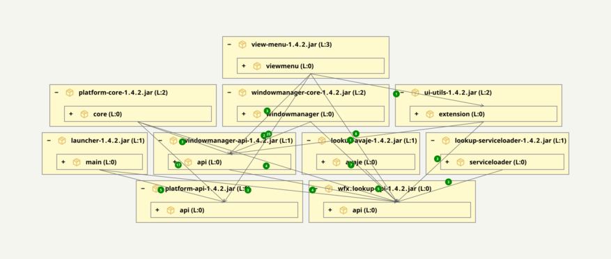
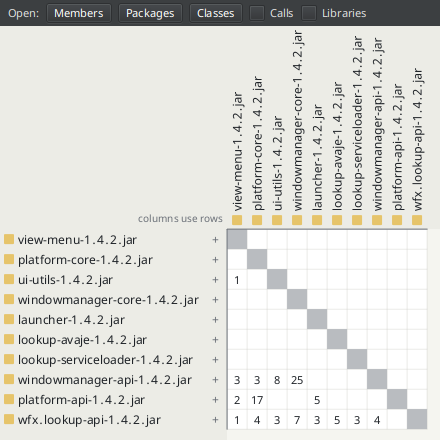

# Physical View

[Handbook home](README.md) · [Layered Architecture View](layered-view.md) ·
[Dependency matrix](matrix-view.md) · [Loading code](loading-code.md)

Packages are the logical structure of a system, the files it is built into are the physical one: a
JAR for every Maven or Gradle module. Both are meant to tell the same story, and often they do not.
**View → Physical View** opens a tab with the same classes, ordered by the files they were read from
instead of by their packages.

The picture shows wfx, the platform S202 is built on, read as its ten module JARs and opened to
depth 1. The files are the outermost boxes and are put into layers like packages: what is used lies
below what uses it. Here the API modules, `platform-api` and `wfx.lookup-api`, are at the bottom,
`windowmanager-api` and the two lookup implementations stand on them, the cores above, and
`view-menu` on top. Every arrow runs down: there is no module that the modules below it need, and no
cycle between modules.

## What it answers

| Question | Where to look |
| --- | --- |
| In which layers do the modules stand? | The rows of the files. |
| Do modules depend on each other in a circle? | Red arrows between files, and the tangle in [Top Tangles](tangle-view.md#top-tangles). |
| Which module uses which, and how much? | The arrows with their numbers, or the [matrix](#the-matrix). |
| Which classes carry a dependency between two modules? | Click the arrow; [Dependency Details](window.md#dependency-details) lists them. |
| Do packages and modules have the same boundaries? | Split packages, see below. |

## In a file

Inside a file the packages and classes are drawn as in the
[Layered Architecture View](layered-view.md). Packages that hold nothing but one other package, like
`io.softwareecg.wfx` in every module of wfx, are not drawn, just as at the top of the layered view.

A package with classes in more than one file is a **split package**. Its box says `⧉ split`, and its
tooltip names the other files. The module system of Java does not allow split packages, and they
show where the boundary of a package and that of a module disagree: either the package or the module
is cut in the wrong place.

## Everything else

The tab is a layered tab like any other. Arrows, violations, cycles, [Find](layered-view.md#finding-a-class-or-package),
[transitive marks](layered-view.md#transitive-users-and-dependencies), [From / To](window.md#from--to)
and the panels work on the files as they do on packages. **Open Scope** on a file opens a tab with
that module alone.

The panels show the names without the file: `io.softwareecg.wfx.windowmanager.impl`, not the name
of the JAR in front of it. Where a package is split, the same name appears for each of its files.

A cut made here is a cut of the analysis and shows in every tab of it, and the other way round.
[Moves](layered-view.md#moving-boxes) stay in the tab: here they answer what would change if a class
lived in another module. The Component and Hexagonal View opened from here show the packages of the
whole analysis.

## The matrix

**Matrix** in the toolbar opens the [matrix](matrix-view.md) of the tab: the files against each other.

All numbers lie below the diagonal, so no module uses one that stands above it. The biggest number
says that `windowmanager-core` uses `windowmanager-api` with 25 class dependencies. **+** on a file
opens it into its packages.

## When there is one

The view needs classes from at least two files. With one JAR, Python, Go, JavaScript or C source, or
a project file saved before release 1.7.0, which did not record where a class was read from, the
menu entry says that there is nothing to show; open the JARs again.

[Next: Horizontal Slice →](slice-view.md)
