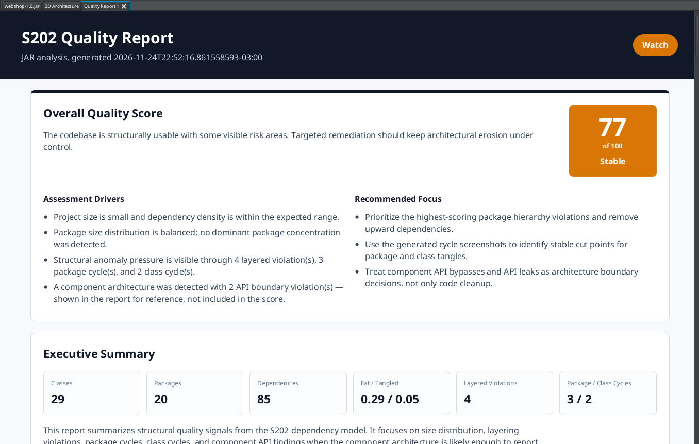
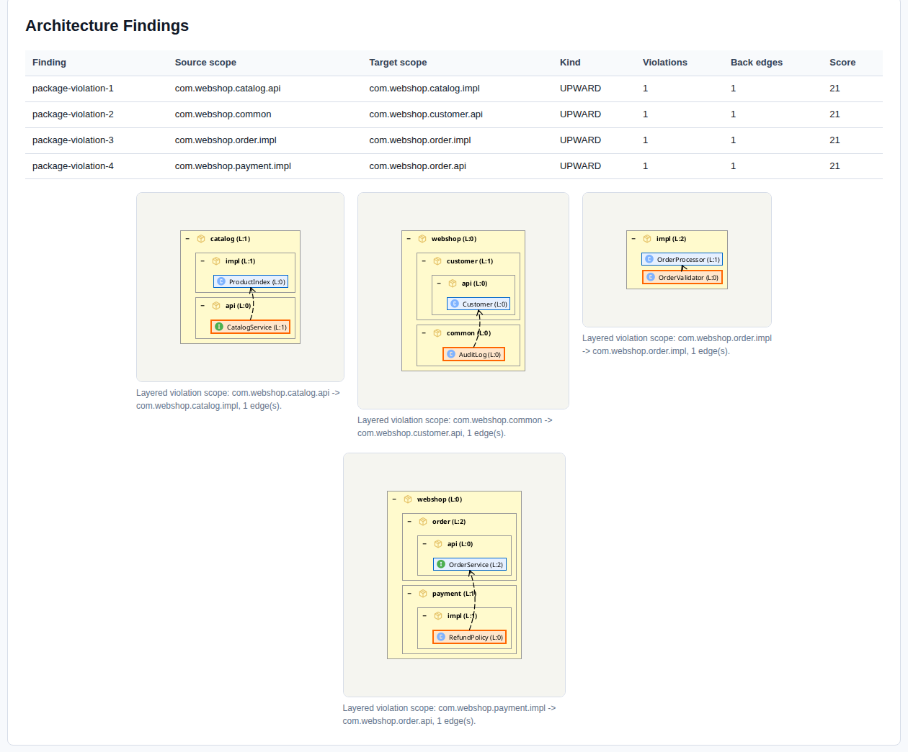
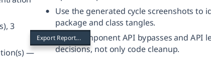

# Quality

[Handbook home](README.md) · [Concepts](concepts.md) · [The window](window.md) ·
[Projects and export](projects-and-export.md)

Two answers to *how good is the structure*: a plot that is always there, and a report for others.

## The Quality panel

The panel at the lower left of the [window](window.md) shows the analysis as a point. Green, at the
lower left, is healthy; red, at the upper right, is not.

| Axis | Meaning | 0 | 1 |
| --- | --- | --- | --- |
| Fat | How many other classes a class depends on, on average | none | 10 or more |
| Tangled | The share of the dependencies that lie on a class cycle | none | all |

With a package selected, the point is that of its classes, and *Scope* names it. In a
[scope](layered-view.md#scopes) tab without a selected package it is that of the classes shown.

The two numbers describe, they do not judge: a small system is fat rather easily, and package
cycles that are no class cycles do not count for *Tangled*. They are good for comparing packages of
a system, and states of a system over time.

## The Quality Report

**File → Analyze Quality** computes a report of the active analysis and opens it in a tab. The
numbers are those of the whole analysis; the pictures are made from what the active tab shows, so
open it from the layered tab of the whole analysis.

| Section | Content |
| --- | --- |
| Overall Quality Score | A number from 0 to 100, what influenced it most, and what to look at first. The badge at the top right sums up the findings: Healthy, Watch, Risk or Critical. |
| Executive Summary | Classes, packages, dependencies, fat and tangled, violations, cycles. |
| Codebase Profile | Where the code comes from, languages, interfaces, dependencies by kind. |
| Size Distribution | The largest packages, those with the most dependencies, and the levels. |
| Quality Overview | The plot of the panel, with the numbers. |
| Architecture Findings | The groups of violations, the heaviest first, with pictures. |
| Cycle Findings | Package and class cycles, with pictures. |
| Component Findings | Components, API bypasses and API leaks. If the code does not look as if it had components (at least two, with at least 35 % of the classes in them), the section only says why. |
| Appendix | Invariants, and the violations one by one. |

The score begins at 100 and loses points

- for size and for many dependencies per class,
- for packages that are much larger than the others, and for many levels,
- for fat and tangled, violations, package cycles and class cycles.

| Score | Label |
| --- | --- |
| 85 and more | Strong |
| 70 to 84 | Stable |
| 55 to 69 | Needs Attention |
| 40 to 54 | High Risk |
| less | Critical |

The score is a heuristic over static dependencies, with the same thresholds for every system. It is
good for comparing versions of one system, not for ranking different ones, and it is no release gate
on its own.

Component findings are not part of the score, because whether a system has components is a guess if
nothing declares it.

A section shows at most ten findings, and pictures of the first five. From 1500 classes on there
are two pictures, from 4000 classes on one, because drawing them takes time.

### Exporting the report

The report lies in a temporary directory. Right-click in it and choose **Export Report...** to copy
it with its pictures to a directory of your choice. The file `index.html` opens in every browser.

[Next: Planning a refactoring →](refactoring.md)
