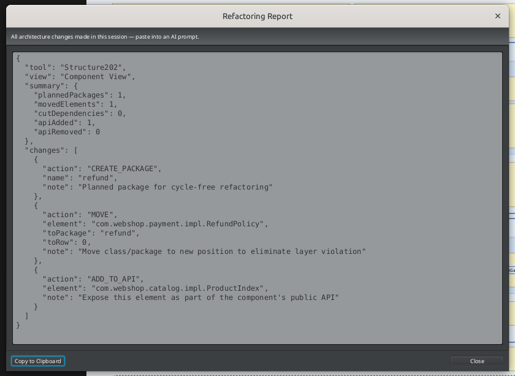
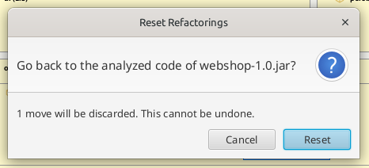

# Planning a Refactoring

[Handbook home](README.md) · [Layered Architecture View](layered-view.md) ·
[Tangles](tangle-view.md) · [Component View](component-view.md)

S202 does not change code. It is the place where a change is tried before it is made, and its
result is a list. This page puts the steps together.

## A way to work

1. **Get an overview.** Open the code, look at the top rows of the
   [layers](layered-view.md), and set **Depth** so that the main packages are closed. Does the
   order match what the team believes?
2. **Choose one tangle.** Take it from [Top Tangles](tangle-view.md#top-tangles), where those with
   packages come first. In a large system open a [scope](layered-view.md#scopes) and begin there.
3. **Understand it.** Open it in a [Tangle View](tangle-view.md#the-tangle-view). Which direction is
   intended? What [carries](window.md#dependency-details) the other one?
4. **Decide.** Try a [move](layered-view.md#moving-boxes) if a class is in the wrong place, or
   [cut](tangle-view.md#cutting) the dependency that has to go. The numbers show at once what is
   left.
5. **Draw the boundary.** In the [Component View](component-view.md) mark what is meant to be
   public, and plan packages that are missing.
6. **Hand it over.** Write the [refactoring report](#refactoring-report).
7. **Check.** Build the changed code, open it again, and compare.

Steps 2 to 4 are repeated. Resolve tangles one by one: a resolved one often changes the others.

## What can be planned

| Plan | Made by | Belongs to | Stored in the project file |
| --- | --- | --- | --- |
| Move of a class or package | dragging it in a layered, scope, component or tangle tab | the tab | no |
| Planned package | [Component View](component-view.md#moving-and-planning) | the tab | no |
| API mark | **Add To Api**, **Remove From Api**, or dragging | the analysis | yes |
| Role or port | [Hexagonal View](hexagonal-view.md#roles-and-ports) | the analysis | yes |
| Cut | **Cut**, **Cut All** | the analysis | yes |

What belongs to a tab is lost when the tab is closed. Export the report first.

## Violation report

**File → Export Violations...** writes what S202 found in the analyzed code, with the rule that is
broken and the methods involved. It is meant to be given to a developer or to an AI assistant. The
one of the sample project begins like this, shortened:

```text
Architecture Violations
=======================

Analysis:  webshop-1.0.jar
Source:    /home/demo/projects/webshop/target/webshop-1.0.jar
Found:     1 past a component API, 1 API leaks, 4 against the layers, 3 package cycles, 2 class cycles

1. Access past the API of a component
-------------------------------------
Rule: code outside of a component uses its public classes only, i.e. the ones in its
sub-packages api and spi or marked as API. Everything else is private. To fix one, use the
API of the component, add what is missing there, or move one of the classes.

Component com.webshop.payment
  public: com.webshop.payment.api, com.webshop.payment.spi
- com.webshop.ui.RefundScreen -> com.webshop.payment.impl.CardPayments (calls refund; uses)
```

Moves are not applied. API marks are, so a leak that was marked away is not reported. A dependency
you have cut is listed with `[planned to be removed]`.

## Refactoring report

**File → Export Refactoring Report...** writes what you planned: new packages, moves, the changed
component mapping with its effect, what becomes of the component violations, roles and ports, and
the dependencies to remove. Planning as in the last picture of the
[Component View](component-view.md#moving-and-planning) gives, shortened:

```text
1. New packages
---------------
- refund

2. Moved to another package or component
----------------------------------------
[webshop-1.0.jar · Component View]
- class com.webshop.payment.impl.RefundPolicy
    from: com.webshop.payment.impl (component payment)
    to:   new package refund (API)

3. Component mapping
--------------------
- add to API:      class com.webshop.catalog.impl.ProductIndex

Effect:
- component com.webshop.catalog
    now public:  com.webshop.catalog.impl.ProductIndex

4. Component violations
-----------------------
- access past the API of a component: 1 -> 1
- API that exposes the implementation: 1 -> 0
solved:
    com.webshop.catalog.api.CatalogService -> com.webshop.catalog.impl.ProductIndex
```

Both reports contain the paths of the analyzed files. If nothing was planned, S202 says so and
writes no file.

### JSON

The menu of the background of a Component View has **Refactoring Report as JSON...**. It contains
the changes of this view, the API marks and the cuts in a form for programs and AI assistants, with
a button to copy it.



## Undo and reset

| Action | What it takes back |
| --- | --- |
| Ctrl+Z and Ctrl+Shift+Z | One move of the active tab, and again |
| **Restore** | One cut |
| **Remove From Api**, **Add To Api** | A mark; the element then has the opposite mark |
| **Refresh** | All moves of the active tab |
| **Edit → Reset Refactorings...**, or **⟲** in the toolbar | Everything planned in the analysis, in all its tabs |

The reset asks first and says what will be lost:



It goes back to the analyzed code without loading it again. Zoom and open packages stay.

[Next: Projects and export →](projects-and-export.md)
