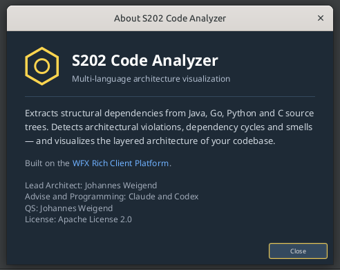

# Reference

[Handbook home](README.md) · [The window](window.md) · [Loading code](loading-code.md) ·
[Projects and export](projects-and-export.md)

## Menus

| Menu | Entry | Key | Effect |
| --- | --- | --- | --- |
| File | Open JAR... | Ctrl+O | [Opens](loading-code.md) one or more JARs. |
| | Open Maven Project... | | Opens the JARs of a Maven build. |
| | Open Gradle Project... | | Opens the JARs of a Gradle build. |
| | Open Source Code | | JavaScript, Go, Python or C source. |
| | Export Image... | Ctrl+E | Saves the view as a [picture](projects-and-export.md#pictures). |
| | Export Violations... | | Writes the [violation report](refactoring.md#violation-report). |
| | Export Refactoring Report... | | Writes the [refactoring report](refactoring.md#refactoring-report). |
| | Analyze Quality | | Opens the [Quality Report](quality.md#the-quality-report). |
| | Show City3D View | | Opens [City3D](3d-views.md#city3d) in the browser. |
| | Save Project... | Ctrl+S | Saves the analysis as a [project](projects-and-export.md#project-files). |
| | Load Project... | | Opens a project. |
| | Close Project | | Closes the analysis with all its tabs. |
| | Exit | Ctrl+Q | Ends S202, after a question. |
| Edit | Undo | Ctrl+Z | Takes a [move](layered-view.md#moving-boxes) back. |
| | Redo | Ctrl+Shift+Z | Makes it again. |
| | Discard Moves of This View | | [Discards](refactoring.md#undo-and-reset) the moves of the tab. |
| | Reset Refactorings... | | [Discards](refactoring.md#undo-and-reset) everything planned. |
| View | Outline Explorer, Quality, Top Tangles, Dependencies, From / To, Hotspots, Dependency Details | | Shows the panel, also a closed one. |
| | 3D Architecture | | Shows the [3D view](3d-views.md#3d-architecture). |
| | Component View | | Opens a [Component View](component-view.md) of the active analysis. |
| | Hexagonal View | | Opens a [Hexagonal View](hexagonal-view.md). |
| | Dependency Matrix | | Opens the [matrix](matrix-view.md) of the active tab. |
| Windows | New | Ctrl+N | An empty tab. |
| | Close | Ctrl+W | Closes the focused tab or panel. |
| | Close All | Ctrl+Shift+W | Closes all analyses and reports. |
| | Default Layout | | The first arrangement of the panels. Open analyses stay. |
| Help | Contribute... | | The project page in the browser. |
| | About... | | What S202 is and who makes it. |

On macOS the Cmd key takes the place of Ctrl.

## Context menus

| Right-click on | Entries |
| --- | --- |
| a line between two classes | Cut, or Restore if it is cut |
| a class or package in a view | Open Scope, Dependencies From Here, Dependencies To Here |
| a name in the matrix | the same, and Open or Close for a package |
| a package in Hotspots | Open Scope, Dependencies From Here, Dependencies To Here |
| a matrix cell that is one class dependency | Cut, or Restore if it is cut |
| a package in the outline | Open Scope |
| the picture of a scope tab | Add to Scope... |
| a tangle in Top Tangles | Cut All |
| a `CUT` dependency in Top Tangles | Cut |
| a planned cut in Top Tangles | Restore |
| an entry of Top Cut Targets | Cut All |
| a class, package or component in a Component View | Add To Api, Remove From Api |
| the background of a Component View | Add Planned Package..., Export Refactoring Report..., Refactoring Report as JSON... |
| a planned package | Rename Package..., Delete Package |
| a class in a Hexagonal View | Mark as Inbound, Outbound or Generic Port, Remove Port, Mark as Core, Mark as Adapter, Clear Hexagonal Role |
| a box or theme in a Hexagonal View | Mark ... as Core, Mark ... as Adapter, Clear ... Role |
| a Quality Report | Export Report... |

## Mouse

| Where | Action | Effect |
| --- | --- | --- |
| any view | Click on a box | Selects it, or lifts the selection. |
| | Ctrl and mouse wheel | Zoom. |
| | Dragging the background | Moves the picture. |
| | Click on an arrow, a violation or the line of a cycle | Selects it; see [Dependency Details](window.md#dependency-details). |
| | Mouse over a class or closed package, with **Show Dependencies** | Its arrows stand out. |
| matrix | Click on a cell, a name | Selects the dependency, the element. |
| | Click on **+**, double-click on a name; click on a band | Opens the package; closes it. |
| layered, scope, component and tangle views | Dragging a box | [Moves](layered-view.md#moving-boxes) it as a plan. |
| Top Tangles | Double-click on a tangle | Opens a [Tangle View](tangle-view.md). |
| Dependencies | Double-click on a wrong-direction edge or a package tangle | Opens a Tangle View. |
| Dependency Details | Click on a method or class | Shows it in the outline. |
| outline | Click on a package or class | Selects it in the view. |
| title of a tab or panel | Dragging | Moves it to another place, or out of the window. |

The keys of the 3D views are in [3D views](3d-views.md).

## Files

| File | Purpose |
| --- | --- |
| `excluded-prefixes.txt` | Classes that are [left out](loading-code.md#what-is-left-out) of Java code. |
| `*.s202.json` | [Project files](projects-and-export.md#project-files). |
| `~/.s202/window.properties` | Size and place of the window. |
| `~/.s202/layout.properties` | Arrangement of the panels. Deleting both files gives the first arrangement at the next start. |

## Settings

| Setting | Kind | Effect |
| --- | --- | --- |
| `s202.python.executable`, `PYTHON` | JVM property, environment variable | The Python to read Python with; otherwise `python3`. |
| `s202.go.executable`, `GO` | JVM property, environment variable | The Go to read Go with; otherwise `go`. |
| `s202.excludedPrefixes` | JVM property | The `excluded-prefixes.txt` to use if none is found in the working directory or above it. |
| `s202.city3d.dist` | JVM property | The directory of the built City3D bundle. |
| `s202.settings.dir` | JVM property | The directory used instead of `~/.s202`. |

## Status of the features

| Feature | Status |
| --- | --- |
| Reading JARs and Maven projects | Stable |
| Reading Gradle projects | Beta |
| Reading Python and Go | Alpha |
| Reading JavaScript | not rated |
| Reading C | PoC |
| Layered Architecture View, Tangle View | Stable |
| Dependencies, violations, class cycles, package tangles | Stable |
| Dependency matrix, From / To, Plan | Beta |
| Libraries outside the analysis, Hotspots | Beta |
| Component View and component checks | Beta |
| Quality Report, layout invariants | Beta |
| 3D Architecture, City3D | not rated |
| Hexagonal View | PoC |

## Known limitations

- Nested classes are not shown; what they depend on counts for the class around them.
- In Java, code that is only reached by reflection or configuration is not seen as a dependency.
- Layers are computed from the dependencies that exist. Which dependency the design forbids, S202
  does not know; see [three different architectures](why-architecture.md#three-different-architectures).
- Static code dependencies do not include change history, shared data, deployment or team coupling;
  see [smells outside the model](architecture-smells.md#smells-outside-the-model).

[Next: Literature →](literature.md)
