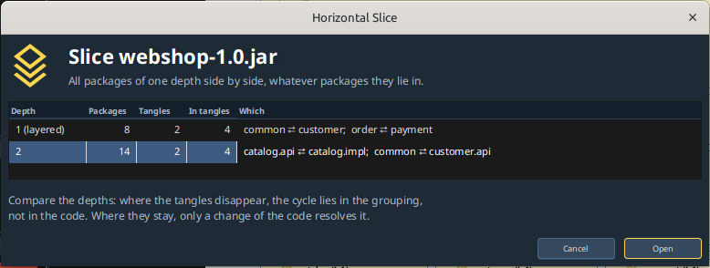
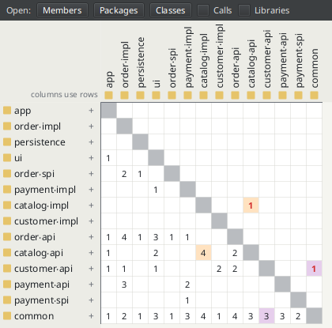

# Horizontal Slice

[Handbook home](README.md) · [Layered Architecture View](layered-view.md) ·
[Tangles](tangle-view.md) · [Dependency matrix](matrix-view.md)

The [Layered Architecture View](layered-view.md) shows packages inside packages, and orders each
package only against its siblings: `order.api` against `order.impl`, `order` against `payment`. A
horizontal slice takes all packages of one depth and puts them side by side, as one picture,
whatever package they lie in. `order.api` then stands next to `payment.impl` and `catalog.api`, and
the order and the cycles are those of all of them together.

## Choosing the depth

**View → Horizontal Slice...** first lists every depth of the active analysis: how many packages
lie side by side there, how many tangles they form, and which.

The depth counts from the packages all classes have in common, `com.webshop` in the web shop.
Depth 1 is what the layered view shows at the top and is listed for comparison. Choose a deeper one
and **Open**: a tab with the slice opens. Packages that do not reach the depth, like `app` or
`common`, stand in the slice as they are; what lies deeper stays inside its package of the slice.

## Comparing depths

The table is read from row to row. In the web shop both depths have two tangles, but not the same:

- `order ⇄ payment` exists at depth 1 only. `order.impl` uses `payment.api` and `payment.impl` uses
  `order.api`, but no way leads back from an `api` to an `impl`. The cycle lies in the grouping of
  the classes into `order` and `payment`, not in the code.
- `common ⇄ customer.api` is a cycle at both depths: here the code itself goes round.
- `catalog.api ⇄ catalog.impl` appears at depth 2. At depth 1 it is hidden inside `catalog`; the
  layered view lists it as a tangle within that package.

A tangle that disappears one depth further down can be resolved by grouping differently. One that
stays needs a change of the code.

## Reading the slice

The tab is a layered tab like any other: arrows, violations, [Top Tangles](tangle-view.md#top-tangles),
[Find](layered-view.md#finding-a-class-or-package), [transitive marks](layered-view.md#transitive-users-and-dependencies)
and the panels work on the packages of the slice. In the picture their names carry a raised dot,
`order‧api`; the panels show them as usual, `com.webshop.order.api`. With many packages side by
side the [matrix](matrix-view.md) of the tab is easier to read than the arrows.

The `api` and `spi` packages lie in the lower half, the implementations above them. Two cells are
coloured: orange, `catalog.api` uses `catalog.impl`, a package cycle that moving a class resolves;
purple, `common` and `customer.api` use each other on a class cycle. A single `1` in the row of
`payment.impl` comes from the column `ui`: the screen uses an implementation instead of the API of
`payment`.

A cut made here is a cut of the analysis and shows in every tab of it. Moves stay in the tab.
**Open Scope** on a package of the slice opens it in the slice. The Component and Hexagonal View
opened from here show the packages of the whole analysis.

[Next: 3D views →](3d-views.md)
