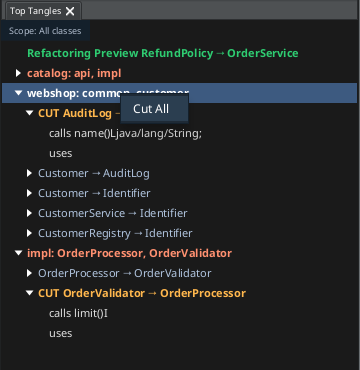
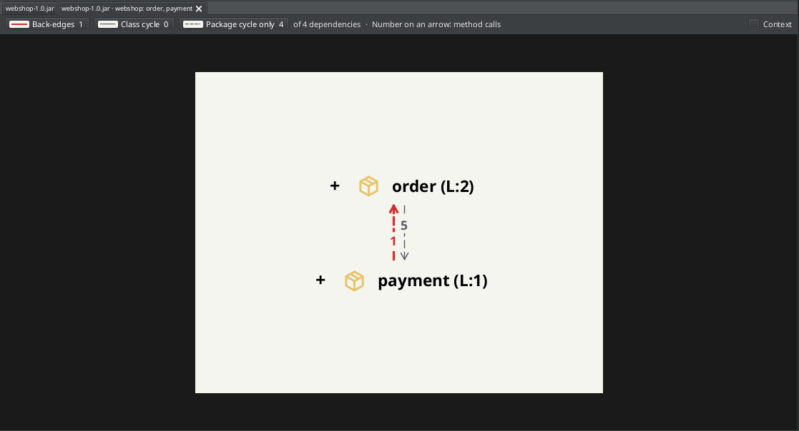
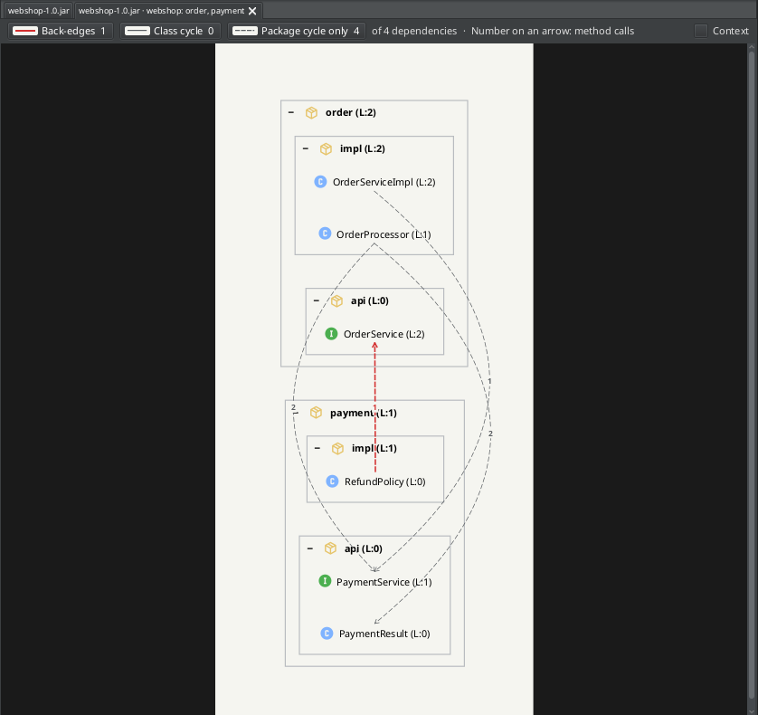
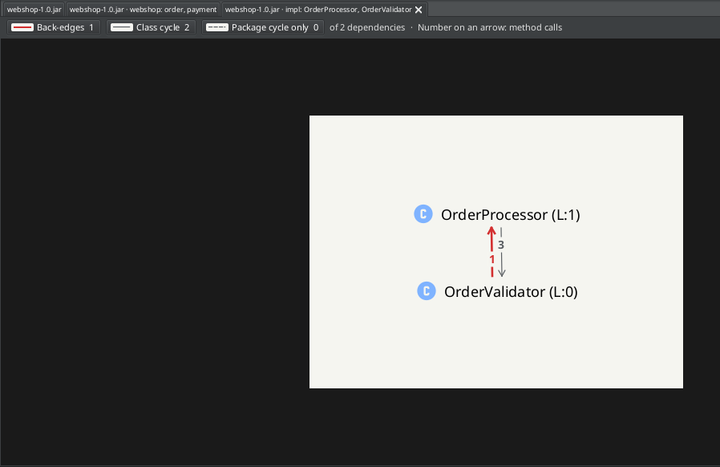
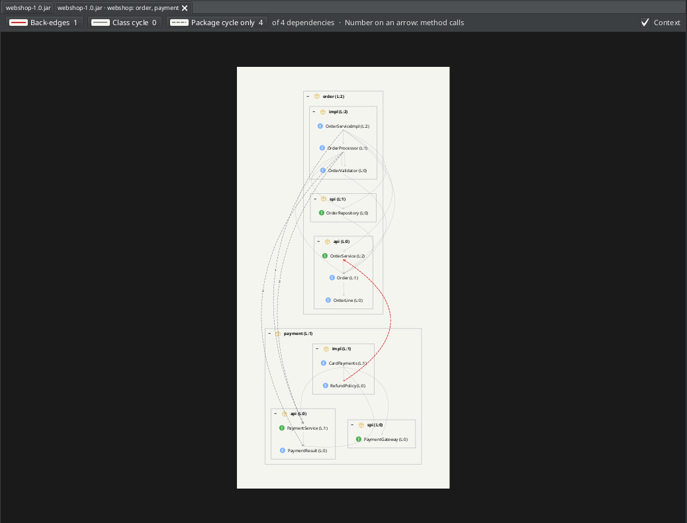
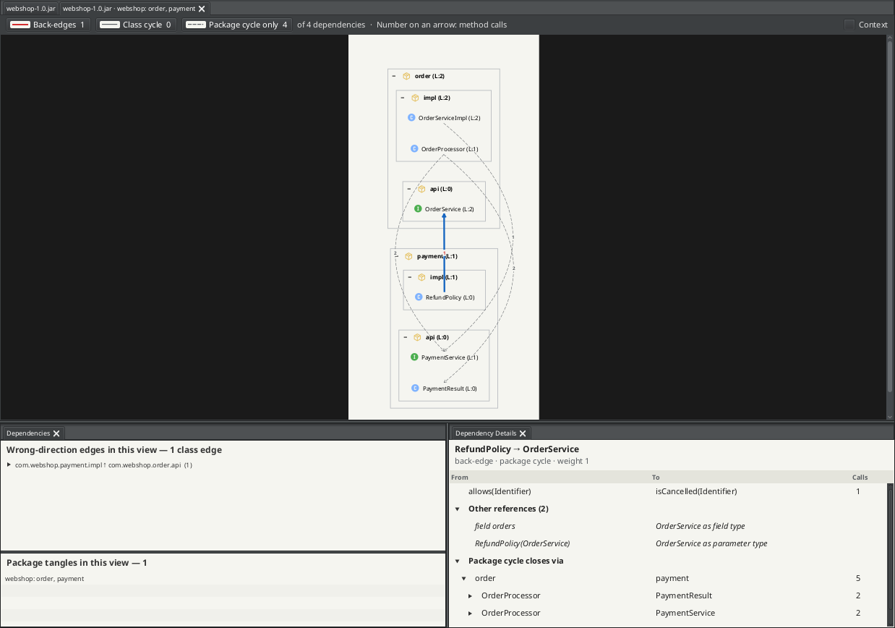
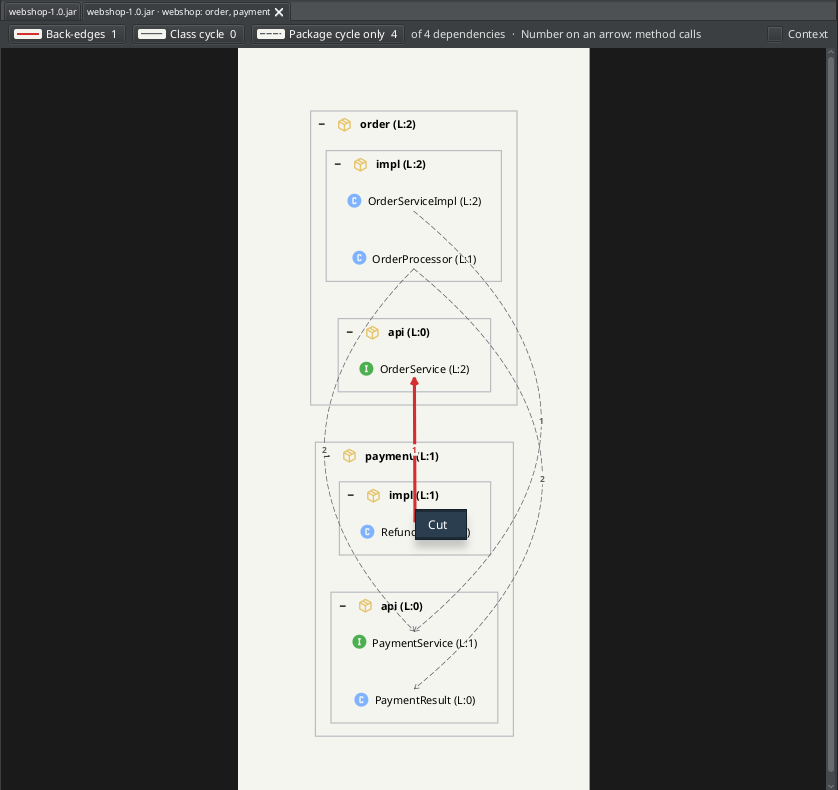
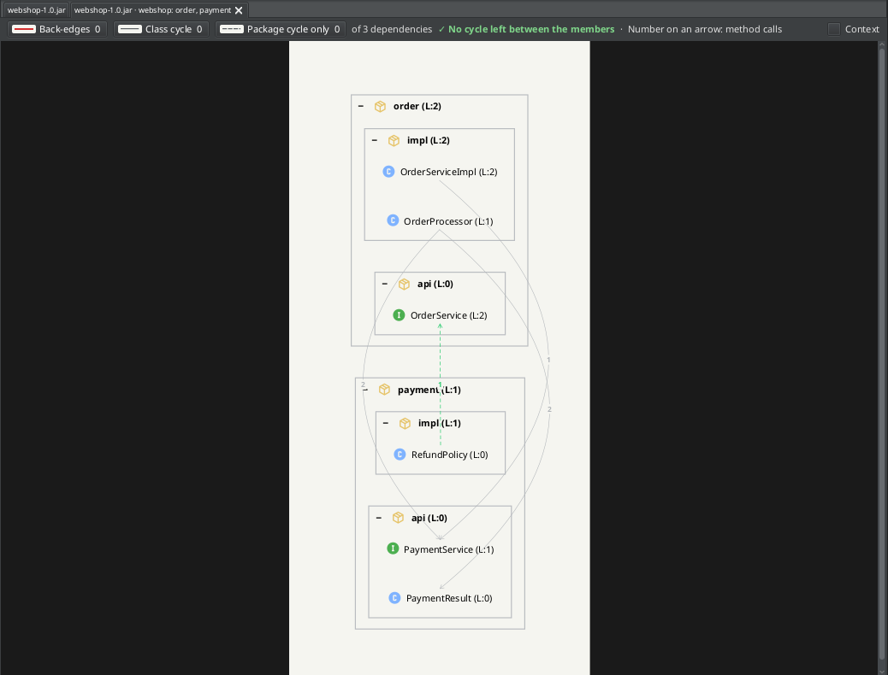
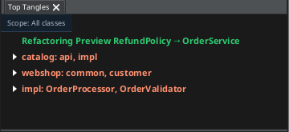

# Tangles

[Handbook home](README.md) · [Concepts](concepts.md) ·
[Layered Architecture View](layered-view.md) · [Planning a refactoring](refactoring.md)

A tangle is a group of members of one package, classes or sub-packages, that depend on each other
in circles. This page is about finding tangles, seeing what holds them together, and choosing what
to cut.

## Top Tangles

The panel lists the five largest tangles: first those with packages in them, then those of classes
only, both by size.

The name of a tangle is the package it lies in and its members: `webshop: common, customer` are
the packages `common` and `customer` in `webshop`.

| Entry | Meaning | Right mouse button |
| --- | --- | --- |
| orange, bold | A tangle. A double-click opens it in a [Tangle View](#the-tangle-view). | **Cut All** cuts all its back-edges. |
| `CUT A → B`, yellow | A class dependency that is a back-edge: proposed for cutting. | **Cut** |
| `A → B`, blue | Another class dependency between members. | |
| below a dependency | What it consists of: calls with the signature, `extends`, `implements`, `uses` ... | |
| `Refactoring Preview A → B`, green | A dependency you have cut. | **Restore** |
| `Top Cut Targets` | Methods that several back-edges call, with the number of back-edges; below a method are the back-edges. Replacing such a method resolves more than one. | **Cut All** cuts these back-edges. |

The first line names the scope. It is taken when a tab comes to the front: the package of a scope
tab, otherwise the package selected there (for a class its package), otherwise *All classes*.

## The Tangle View

A double-click on a tangle opens a tab that shows its members and nothing else. Packages are
closed at first.

The members are arranged in layers as usual, but drawn as a graph: icon and name, without boxes.

| In the picture | Meaning |
| --- | --- |
| Number on an arrow | How many method calls carry the dependency: what it costs to cut it. A dependency without calls counts 1. |
| `12 / 3↑` | An arrow that bundles several dependencies: three of the twelve calls belong to back-edges. |
| Red and heavy | Back-edge: the arrow that runs up, the candidate to remove. |
| Solid | The dependency lies on a class cycle. Only a change of the code resolves it. |
| Dashed | It lies on a package cycle only. Moving a class may be enough. |
| Light grey | It lies on no cycle. |
| Blue | Selected. |
| Green and dashed | Cut. |

Opening the packages with **+**, the sub-packages too, shows the classes behind the arrows, but only
those that take part in the tangle.

The red arrow is the one call of `RefundPolicy`. `spi` of both packages and most other classes are
missing, because they have nothing to do with the cycle.

A tangle of classes is shown directly. This one is solid, because the two classes form a class
cycle:

### The bar above the picture

The bar explains the arrows, counts the dependencies of each kind and filters them.

| Control | Effect |
| --- | --- |
| Back-edges, Class cycle, Package cycle only | A click highlights these dependencies; the others fade. Several can be chosen. |
| Context | Also shows the classes and dependencies of the members that play no part in the tangle. |

The switches **Class SCCs**, **Package Cycles**, **Show Violations** and **Limit Box Width** of the
toolbar are not available in a tangle tab: the arrows already say it all.

Switching **Context** closes the packages again. To open all at once, raise **Depth** and press
**Refresh**.

### What carries an arrow

A click on an arrow marks it blue and fills [Dependency Details](window.md#dependency-details). The
mouse catches the arrows of this view in an area wider than the line, and the numbers belong to it.
If the arrow leads from class to class, the called method is also shown in the outline.

`allows` calls `isCancelled` once, and the class keeps the `OrderService` in a field and takes it in
its constructor. All three places have to change. *Package cycle closes via* shows the other half:
`order` uses `payment` with five calls.

### Other ways to a Tangle View

A double-click on an entry of the panel [Dependencies](window.md#dependencies) opens

- a package tangle,
- or the classes of a wrong-direction edge, with everything that runs between them.

Every entry has one tab, which is reused. The tangle is looked for in what the active tab shows, so
from a [scope](layered-view.md#scopes) tab only the part within the scope appears.

## Cutting

A right-click on an arrow between two classes offers **Cut**, in a Tangle View and on the arrows of
**Show Dependencies** in every other view.

A cut is a preview: the dependency is treated as if it were gone. The arrow stays, thin and green.

The bar now counts no back-edge and no cycle and says *No cycle left between the members*. The
tangle disappears from Top Tangles, and the cut appears there:

If the bar still counts a class cycle although no cycle is left between the members, that cycle
runs through classes outside the tangle.

| Action | Effect |
| --- | --- |
| **Restore** on the arrow, or on the green entry of Top Tangles | Takes the cut back. |
| **Cut All** on a tangle | Cuts all its back-edges in one step. |
| **Edit → Reset Refactorings...** | Takes back all cuts, and everything else that was planned. |

Cuts belong to the analysis: all its tabs show them, and they are stored in the project file. They
do not change the layout, the violations or the panel Dependencies, which show the code as it is.

## Which one to cut

The back-edges are a proposal, made from the numbers. Reasons to choose another one:

- **Design.** The direction that should remain is known: a foundation must not know business
  classes, an API not its implementation, whatever the numbers say.
- **Cost.** A dependency with one call is cheaper than one with twenty. Look at *Other references*
  as well.
- **Effect.** A method in *Top Cut Targets* is called by several back-edges. Its **Cut All** cuts the
  dependencies as a whole: if one of them also calls other methods, these have to go as well.

How to remove a dependency that is cut on paper:

| Situation | Remedy |
| --- | --- |
| Dashed: one class is in the wrong package | Move it, after trying it with a [move](layered-view.md#moving-boxes). |
| The lower part calls the upper one | Let the lower part declare an interface that the upper one implements. `RefundPolicy` would ask an interface in `payment.spi`. |
| Two classes of one package call each other | Pass the value instead of the caller: `OrderValidator` needs the limit, not the `OrderProcessor`. |
| Both directions are heavy | The two are one. Merge them. |

[Next: Component View →](component-view.md)
