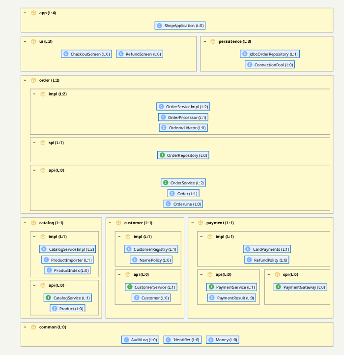
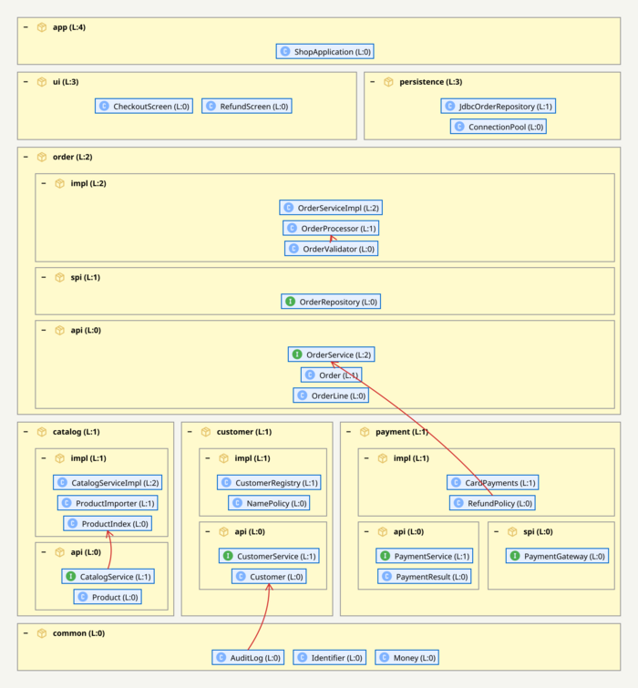
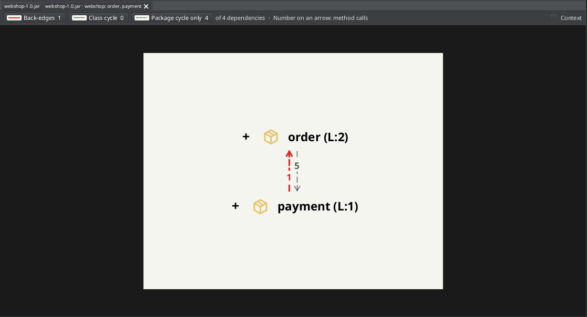

# The Web Shop Story

[Handbook home](README.md) · [Why architecture matters](why-architecture.md) ·
[Getting started](getting-started.md) · [Planning a refactoring](refactoring.md)

The sample project is a small web shop of 29 classes. Its packages and names look tidy: components
for orders, payments, catalog and customers, an application at the top and a `common` foundation at
the bottom. It has five deliberate defects. Each stands for a pattern found in real systems.

This page tells how to judge them. A change request leads to the first two, a look at the rest of
the picture to the other three. Which button does what is said in
[Getting started](getting-started.md#the-first-analysis).

## The change request

The shop refunds an order only after it was cancelled. Now somebody asks for one more condition:

> A refund is possible only within thirty days of the cancellation.

That sounds like a change of one class. The rule is in `RefundPolicy`, in the implementation of
`payment`. But the date of the cancellation belongs to the order, so `RefundPolicy` has to ask for
it where it asks for the cancellation already. The call runs along this chain of dependencies:

```text
ui.RefundScreen → payment.impl.CardPayments → payment.impl.RefundPolicy → order.api.OrderService
```

`OrderService` gets another method, `OrderServiceImpl` has to remember the date, and `order` uses
`payment` itself. A condition of payment has become a change of both components. And at the
beginning of the call is a screen that knows a class of the implementation.

## The picture



The layers look convincing. `app` starts the system, `ui` and `persistence` use the business
components, `order` uses `catalog`, `customer` and `payment`, and all of them stand on `common`. A
review of the package names would end here.

**Show Violations** asks another question: which dependencies contradict this order?



Four arrows run upwards. They are findings 2 to 5. Finding 1 runs downwards and is not among them.

## Finding 1: the screen knows the implementation of payment

`RefundScreen` keeps a `CardPayments` in a field instead of a `PaymentService`:

```text
ui.RefundScreen → payment.impl.CardPayments
```

For the layers this is fine, `ui` may use `payment`. It is an **API bypass**: the screen depends on
a class that belongs to the private implementation of the component. The
[Component View](component-view.md#violations) shows it, because the boundary of a component answers
a question the layers do not ask: which classes may an outsider know?

The remedy is not to make `CardPayments` public. `PaymentService` has the method `refund` already,
so the screen can use the interface.

## Finding 2: payment asks order back

```text
order → payment → order
```

`webshop: order, payment` in **Top Tangles** opens the [Tangle View](tangle-view.md#the-tangle-view):
five calls from `order` to `payment`, one call back.



S202 proposes to cut the one call because little weight runs against much. The design says the
same: to decide on a refund, payment needs a fact about the order, not the component that uses it.

Two experiments:

1. **Move** `RefundPolicy` to `order.impl`. The old violation is gone, but `CardPayments` still
   needs the class, and that dependency [now runs upwards](layered-view.md#moving-boxes). The cycle
   is not a matter of the place of a class.
2. **Cut** `RefundPolicy` → `OrderService`. No cycle is left, and
   [Dependency Details](window.md#dependency-details) lists every place that has to change.

So the code has to change. The caller can pass the fact, or payment can declare an interface in
`payment.spi` that `order` implements. S202 shows that the cut resolves the cycle; the contract that
replaces the call is a decision of the team.

## Finding 3: the API of the catalog exposes its implementation

```text
catalog.api.CatalogService → catalog.impl.ProductIndex
```

`CatalogService.index()` returns a class of the implementation. Whoever calls it has to know that
class. This is an **API leak**. Because the implementation depends on its API in turn, it is a
package cycle as well, and one of the four arrows.

**Add To Api** on `ProductIndex` removes the leak from the Component View. The arrow in the layers
and the package cycle remain, because the code is the same: a mark changes what is regarded as
public, not who depends on whom. The better change is a type of the API as the return value, or to
take `index()` out of the interface.

## Finding 4: the foundation knows a business class

```text
common.AuditLog ↔ customer.api.Customer
```

`AuditLog` takes a `Customer`, and `Customer` calls `AuditLog` when it is renamed. The business may
use the foundation. A foundation that knows the business changes with every feature, and `common`
becomes the place where everything ends up that has no other.

Moving `AuditLog` beside `Customer` resolves the package cycle. The two classes still use each other,
but within one package. Passing a text instead of the `Customer` resolves the class cycle too, and
`AuditLog` can stay where it is.

## Finding 5: two classes of one package call each other

```text
order.impl.OrderProcessor ↔ order.impl.OrderValidator
```

`OrderProcessor` creates an `OrderValidator`, which calls `OrderProcessor.limit()`. Both are private
classes of the same package, so nobody else is affected. If they are always understood, tested and
changed together, the cycle can stay. It costs little to resolve: the validator needs the limit, not
the processor.

Not every arrow has to go. This one is less important than the cycle of `order` and `payment`.

## The result

| Finding | What is wrong | Candidate change |
| --- | --- | --- |
| 1 `RefundScreen` → `CardPayments` | The boundary of `payment` is bypassed. | Use `PaymentService`. |
| 2 `RefundPolicy` → `OrderService` | Two components form a cycle. | Pass the fact, or an interface in `payment.spi`. |
| 3 `CatalogService` → `ProductIndex` | The API exposes an implementation class. | Return a type of the API, or remove the method. |
| 4 `AuditLog` ↔ `Customer` | The foundation knows the business. | Pass a text, or move `AuditLog`. |
| 5 `OrderValidator` ↔ `OrderProcessor` | Two private classes are tightly coupled. | Pass the limit, or leave it. |

Instead of *improve the architecture* there is now a list of dependencies and changes that can be
discussed. How it is made and handed over is the subject of
[Planning a refactoring](refactoring.md).

[Next: Architecture smells →](architecture-smells.md)
