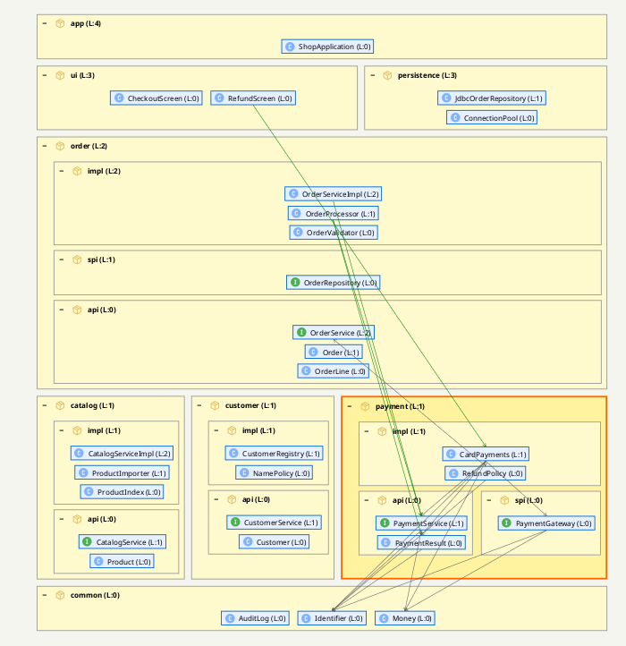

# Why Architecture Matters

[Handbook home](README.md) · [Concepts](concepts.md) · [The web shop story](webshop-story.md) ·
[Architecture smells](architecture-smells.md)

A system of some size does not fit into one head. Architecture is the key to keeping the overview all
the same: to understanding the system, to developing and replacing its parts, and to turning a complex
whole into a technical product that can be mastered.

## Divide and conquer

Engineering has an old answer to complexity: decomposition. The whole is divided into parts that can
be dealt with one at a time, and the parts are divided again. A good decomposition gives

| Benefit | What it means |
| --- | --- |
| **Overview** | A few parts with a clear order explain the whole. Details are needed only where the work is. |
| **Understanding** | A part stands for a subject of the domain. An expert for security who wants to know how passwords are handled, and whether the authentication is up to date, reads one component and not the whole system. |
| **Time** | Parts with agreed contracts are developed at the same time, by different people. |
| **Replacement** | A part can be exchanged without touching the others: the payment provider, the database, a library that is out of date. |
| **Change** | What is likely to change is in one place. |

It is not a new insight. [Parnas](literature.md#modules-components-and-dependency-rules) named these
benefits of modules in 1972: a shorter development time, because separate groups work on them;
flexibility, because one can be changed without the others; and comprehensibility, because the system
can be studied one module at a time.

Dividing is the easy half: packages are quickly made and named. Whether the parts can be conquered one
at a time, the dependencies between them decide.

- In a cycle no part can be understood, tested or replaced without the others.
- If the API of a component is bypassed, the component cannot be exchanged without changing the code
  outside, and the expert who reads it does not see what is done past it.
- If the parts are named after technology instead of subjects, every subject is spread over all of
  them, and there is no component the expert could read.

That is why S202 draws dependencies. Each class can look reasonable on its own; the problem is in the
relationships between them, and that is the scale at which architecture becomes visible.

## The cost of change

The consequence that is felt every day is the cost of a change. One more condition for a refund sounds
local, and then both the payment and the order component have to be changed;
[the web shop story](webshop-story.md) follows this change through the code. The question is:

> When this part changes, which other parts must be understood, tested and changed with it?

Dependencies carry that cost. If `A` depends on `B`, a change to the contract or behaviour of `B`
may force work in `A`. The arrow does not say that a change will propagate; it shows where it can.
Long chains, wide fan-out and cycles increase the amount of code that may have to be considered
together.

Good architecture does not mean having few dependencies. Useful software necessarily connects
things. It means that the dependencies express deliberate responsibilities and that likely changes
remain local:

- business rules do not depend on screens or databases;
- clients know a component's contract, not its implementation;
- a foundation does not know the business concepts built on top of it;
- parts intended to change independently do not form a cycle.

## Three different architectures

When reading an S202 view, keep three things separate:

| Kind | Question | Where it comes from |
| --- | --- | --- |
| **Observed architecture** | Which dependencies exist in the analyzed code? | Bytecode or source code. |
| **Inferred architecture** | Which order and groups best explain those dependencies? | Levels, back-edges, rings and themes computed by S202. |
| **Intended architecture** | Which dependencies and boundaries should exist? | Design decisions and team knowledge; in S202 package names, annotations, API marks, roles and planned moves. |

S202 begins with the first and computes the second. It cannot invent the third. A back-edge is a
candidate for investigation, not a verdict that this particular dependency is wrong; the architect
decides which direction expresses the design.

It works the other way as well. A dependency may run down through the layers and still be
undesirable: `ui` → `database` can be ordered without a cycle, but may go past the application that
was meant to lie between. A computed layer order cannot know that. The
[Component View](component-view.md) finds such a dependency if it enters a private implementation.

## Four lenses on the same code

S202 shows the same dependencies through different lenses. None replaces the others.

| Lens | It asks | Its principal rule | Typical finding |
| --- | --- | --- | --- |
| [Layers](layered-view.md) | What rests on what? | Dependencies run in one direction. | Back-edge, cycle, surprising depth. |
| [Components](component-view.md) | Who may know this implementation decision? | Outsiders use the API; the implementation depends on the API, [not the other way round](component-view.md#the-inverted-layers). | API bypass, API leak. |
| [Hexagonal architecture](hexagonal-view.md) | What is core, application and adapter? | Dependencies point inward, and adapters meet the application at ports. | Outward dependency, port bypass. |
| [Tangles](tangle-view.md) | What cannot be ordered independently? | Parts meant to be separate do not depend on one another in a circle. | Class or package cycle. |

Layers order dependencies, components hide decisions. These two boundaries are independent: a layer
can contain several components, and a component has layers of its own. Hexagonal architecture gives
the parts a role. A tangle is no architecture style at all; it can occur in any of them.

## Reviewing an unknown system

A review of code has many parts: tests, error handling, security, performance, the code itself. The
structure is only one of them, but a central one, because it tells where to look and how to read
what is found there. The author of S202 has used a tool of this kind in every code review.

The main benefit comes from the picture, not from the list of violations. A violation is often a
blemish, a detail somewhere below; not always, but the large questions are answered before the first
one is drawn. So the order is: the picture, the arrows, the cycles.

### First the picture alone

Leave everything switched off. Begin with closed packages and open them level by level, with
[Depth](layered-view.md#package-depth) or with **+**.

| Look at | Ask |
| --- | --- |
| Size | Are the boxes as large as expected? Is there something large that nobody has mentioned? |
| Names | Are they understandable? Do they say what the system is about, or are all of them technical? |
| Order | Is it plausible, on the first and on the second level, what rests on what? Which box is not where one would look for it? |

For the size, open the packages and switch on [Limit Box Width](layered-view.md#box-width). A closed
box does not show how much is in it, and without the switch the boxes of a row share its width.

The names of packages and classes are the terms of the domain as the developers understood them, and
their places say how the terms are related. In the [web shop](webshop-story.md#the-picture) one sees
without reading any code that an order is about a catalog, customers and payments. Packages named
after technology only, such as `controller`, `service` and `dao`, say that the domain was not the
principle of division.

What cannot be explained here is a question for the first talk with the team.

### Then the arrows

Switch on [Show Dependencies](layered-view.md#dependencies) and select one package after the other.
Green comes in, grey goes out. Now one sees whether a package has an entrance.

| In the picture | What it is |
| --- | --- |
| The green arrows meet at a few classes | A component with a facade or an API. These classes tell what it is for and how it is used: read them first. |
| Green arrows from everywhere to many of its classes, little grey | A library. Right for `Money` and `Identifier`, a problem if it is business code. |
| Green arrows to many of its classes, and a lot of grey | A folder: it has a name, but no entrance and no boundary. |
| No green arrow | It starts something, it is reached only by configuration or reflection, or it is dead. |
| Much more grey than in its neighbours | It coordinates the others, or it knows too much. |

`payment` is a component: `order` comes in at `api` only. One green arrow goes past the entrance, from
`RefundScreen`. `common` is a library; everybody uses its classes directly.

The entrance of a component lies at its bottom in this view, and the arrows run across the
implementation. That looks less orderly than it is; the [Component View](component-view.md#the-inverted-layers)
shows the same with the entrance on top.

### The cycles last

Rows alone prove nothing: S202 finds an order even in a big ball of mud, because it ignores
[back-edges](concepts.md#violations) to get one. How much of the order is real, the cycles say. A few
of them are normal and usually concern a detail. What counts is whether they are the exception.

| | An architecture | A big ball of mud |
| --- | --- | --- |
| [Show Violations](layered-view.md#violations) | A few arrows, each with a story. | Arrows from everywhere to everywhere. |
| [Top Tangles](tangle-view.md#top-tangles) | Small groups. | One tangle that contains most of the main packages. |
| [Quality panel](quality.md#the-quality-panel) | The point is low: *Tangled* near 0. | The point is high: a large share of the dependencies lies on class cycles. |
| [Component View](component-view.md) | Packages with an API that is used. | No boundaries, or boundaries everybody ignores. |

### What to take along

The [Quality Report](quality.md#the-quality-report) gives size, distribution, coupling and cycles in
numbers. The views give the examples: a dependency can be followed down to the
[calls and references](window.md#dependency-details) that carry it. With examples a finding can be
discussed with the developers, with a number alone it cannot.

## What static dependencies can and cannot say

Every relationship S202 draws comes from the analyzed code and can be followed down to the calls and
references that carry it. It is still a partial model. From static code alone it does not know

- which business capabilities should change together;
- which dependencies exist only through configuration or reflection;
- which files repeatedly change together in version history;
- which services share a database, a deployment or a failure mode;
- whether a finding is an intentional trade-off.

Treat the picture as an architecture hypothesis: inspect it, compare it with the team's intent, then
make that intent more explicit. S202 does not replace the architect. It makes the architect's
questions answerable in concrete code.

The ideas behind this page are collected in [Literature](literature.md).

[Next: Concepts →](concepts.md)
