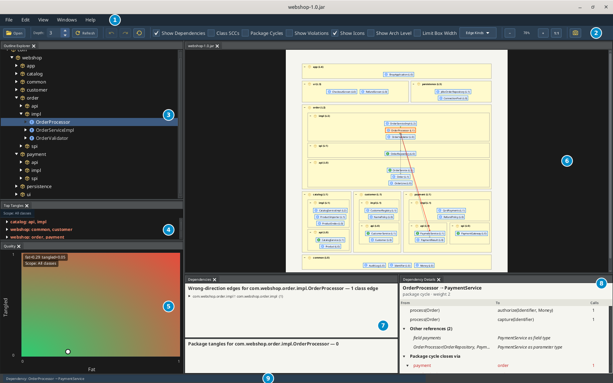
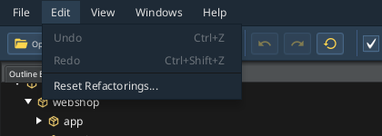
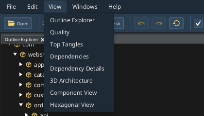
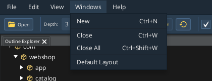
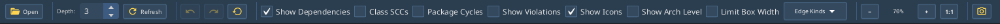
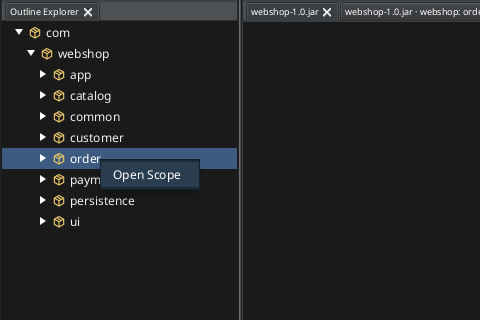
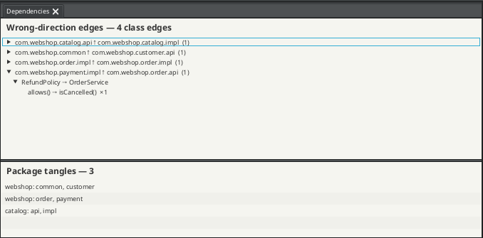
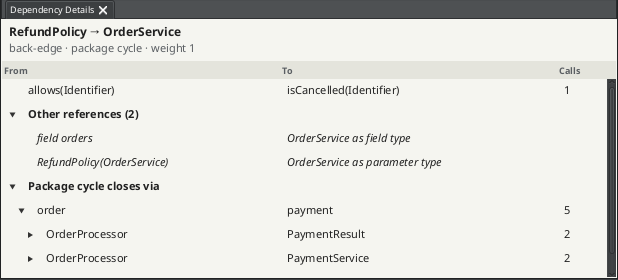
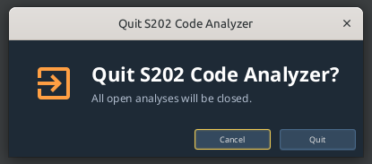

# The Window

[Handbook home](README.md) · [Loading code](loading-code.md) ·
[Layered Architecture View](layered-view.md) · [Reference](reference.md)

| | Part | What it is for |
| --- | --- | --- |
| 1 | [Menu bar](#menus) | Opening, exporting, saving; views and panels. |
| 2 | [Toolbar](#toolbar) | How the picture of the active tab is drawn. |
| 3 | [Outline Explorer](#outline-explorer) | Packages, classes and methods as a tree. |
| 4 | [Top Tangles](tangle-view.md#top-tangles) | The cycles of the analysis, and the planned cuts. |
| 5 | [Quality](quality.md#the-quality-panel) | The analysis as a point between healthy and unhealthy. |
| 6 | [Tabs](#tabs) | The views: layers, components, hexagon, tangles, scopes, reports, 3D. |
| 7 | [Dependencies](#dependencies) | Violations and package tangles as a list. |
| 8 | [Dependency Details](#dependency-details) | What carries the selected arrow. |
| 9 | [Status bar](#status-bar) | What was done last, and the progress of what is being done. |

The panels 3, 4, 5, 7 and 8 always belong to the active tab: the one you worked in last. They
keep showing it while you work in a panel.

## Menus

|  |  |  |
| --- | --- | --- |

The **File** menu is shown in [Loading code](loading-code.md). **Edit** undoes and redoes
[moves](layered-view.md#moving-boxes) and [resets](refactoring.md#undo-and-reset) all planned
changes. **View** shows a panel that was closed, and opens the 3D, Component and Hexagonal View.
**Windows** handles tabs and layout. All entries are listed in the
[Reference](reference.md#menus).

## Toolbar

| Control | Effect |
| --- | --- |
| Open | Opens JARs, a Maven or a Gradle project. |
| Depth | How many levels of packages are open after building the picture; applied with **Refresh**. |
| Refresh | Builds the picture of the tab anew. Discards the moves of the tab. |
| ↶ ↷ | Undo and redo a move. |
| ⟲ | Resets everything that was planned in this analysis: moves, API marks, cuts. Asks first. |
| Show Dependencies | The [arrows](layered-view.md#dependencies). |
| Class SCCs | Class cycles, in red. |
| Package Cycles | Package cycles, in orange. |
| Show Violations | The dependencies that break the rules of the view, black. |
| Show Icons | The symbols of packages, classes and interfaces. |
| Show Arch Level | The global level `G:n` beside the local level `L:n`. |
| Limit Box Width | Keeps boxes [compact](layered-view.md#box-width). |
| Edge Kinds | Which [kinds of dependency](layered-view.md#edge-kinds) are drawn. |
| − 100% + | Zoom. |
| 1:1 | Zoom 100 %. |
| Camera | Saves the view as a [picture](projects-and-export.md#pictures). |

The toolbar shows the settings of the active tab; every tab has its own. **Show Icons** and **Show
Arch Level** are common to all. Every control has a tooltip. If the window is too narrow, the last
controls are behind the arrows **»** at the right end.

## Tabs

A tab is closed with the cross on it or with Ctrl+W. The last tab of an analysis closes the
analysis, without asking.

Tabs and panels can be dragged by their title: onto another tab to share its place, to an edge of
an area to divide it, or out of the window to become a window of their own. The lines between the
areas are dragged with the mouse.

A closed panel comes back with the **View** menu. Size and position of the window and the
arrangement of the panels are remembered for the next start.

**Windows → Default Layout** puts the panels where they were at first, shows those that were closed
and hides the 3D view. Open analyses and reports stay; their tabs go back into the middle, also those
that had a window of their own.

**Windows → New** opens an empty tab; it has no use of its own.

## Outline Explorer

The tree contains what the active tab shows: for the layered view everything, for a tangle or a
scope only its part.

| Action | Effect |
| --- | --- |
| Click on a package or class | Selects it in the view and scrolls to it. |
| Selecting in a view | Opens the tree at that place. |
| Right-click on a package, **Open Scope** | Opens a tab with [this package alone](layered-view.md#scopes). |

Below a class are its methods with their signatures. They are the goal of a click in
[Dependency Details](#dependency-details).

## Dependencies

| Section | Content |
| --- | --- |
| Component violations / Hexagonal violations | Only in the [Component](component-view.md#violations) and the [Hexagonal View](hexagonal-view.md#violations): what breaks the rules of that view. |
| Wrong-direction edges | The violations of the layers, grouped by package. Below a group are the class dependencies, below these the calls with their number. In the Component and the Hexagonal View this section is empty. |
| Package tangles | The tangles with at least one package in them. |

With a class or package selected, the list is limited to it, and the headings say so. A click on
the selection in the view lifts that. In a tangle tab the list contains what lies between the
classes shown; in a scope tab without a selection it is that of the whole analysis.

A double-click on an entry of *Wrong-direction edges* or *Package tangles* opens it in a
[Tangle View](tangle-view.md).

The panel follows [moves](layered-view.md#moving-boxes): it shows how many violations would be
left. It does not follow [cuts](tangle-view.md#cutting).

## Dependency Details

A click on an arrow of **Show Dependencies** or of a [Tangle View](tangle-view.md) shows what it
consists of; the black arrows of violations and the lines of cycles cannot be clicked. The line
below the name sums up: whether the dependency is a back-edge, on which kind of cycle it lies, and
its weight.

| Rows | Meaning |
| --- | --- |
| Calls | The calling method, the called one, and how often. |
| `extends`, `implements`, `imports` ... | Inheritance and imports. |
| Other references | The places that mention the class without calling it: fields, parameters, casts. They keep the dependency alive even when every call is removed. |
| Cycle closes via | The shortest way back, which makes the dependency part of a class cycle. |
| Package cycle closes via | The same for a package cycle. Every step can be opened down to the calls. |

The arrow of a collapsed package stands for many class dependencies. They are listed with the
back-edges first, and each can be opened.

A click on a method or class shows it in the outline. Every tab remembers its selected arrow.

## Status bar

The left side says what was done last, and the bar on the right shows progress while something is
running. Texts such as *What-If: RefundPolicy → com.webshop.order.impl — marked as moved* confirm
every planned change.

## Leaving

**File → Exit** and closing the window ask first. There is no question about unsaved projects:
save them with **File → Save Project...** beforehand.

[Next: Layered Architecture View →](layered-view.md)
