# S202 Component Design

A collection of decoupling and component design decisions for S202.
This document grows with new insights.

## Goal: Case Study

Carrying out the measures worked out here is at the same time a
**case study for S202 itself**. Every step is documented with a before/after
comparison: which violations and dependencies the tool showed before the
measure, which design decision followed from them, and what the picture
looks like afterwards.

The decisive point: the entire analysis in this document was derived
**exclusively from the tool** — no direct look at the source code. Legacy
code, wrong package boundaries, API surfaces that were too wide and missing
interfaces became visible through the layered and component views of
S202, not through manual code reading.

This makes S202 the tool of its own improvement — and the results a
traceable example of what the tool can do in real codebases.

---

## 1. `reader` as a component with a hidden implementation

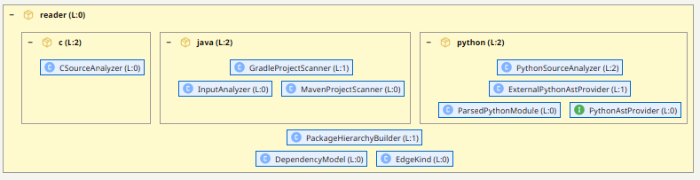

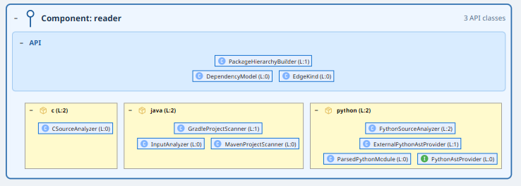

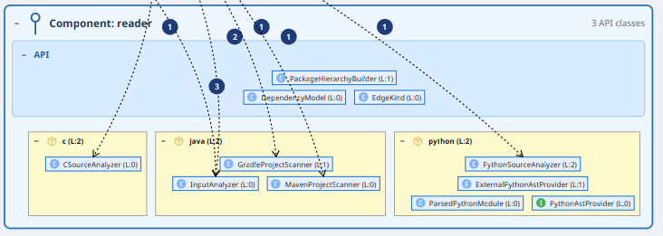

### Problem

`S202Module` knows all the internals of the `reader` package:

```
de.weigend.s202.reader.java.InputAnalyzer
de.weigend.s202.reader.java.MavenProjectScanner
de.weigend.s202.reader.java.GradleProjectScanner
de.weigend.s202.reader.python.PythonSourceAnalyzer
de.weigend.s202.reader.c.CSourceAnalyzer
```

Today, a new language requires a change in `S202Module`.

### Goal

`reader` becomes a component. The UI sees only the component API:

```
de.weigend.s202.reader.LanguageAnalyzer    ← interface (API)
de.weigend.s202.reader.AnalyzerRegistry   ← entry point (API)
```

Everything under `reader.java.*`, `reader.python.*`, `reader.c.*` is an
implementation detail of the component. The concrete analyzers are
registered internally — via SPI or a static registry; that is an
implementation decision inside the `reader` module.

### Interface

```java
public interface LanguageAnalyzer {
    String displayName();
    DependencyModel analyze(List<Path> inputs) throws IOException;
}
```

`InputAnalyzer` converts `path.toString()` internally. Python and C already
take `Path`. The progress callback remains an optional overload on
`InputAnalyzer` — it is a UI concern, not part of the analyzer contract.

### FileLoader on the UI side

The UI knows how to obtain input for known analyzers:

```java
interface FileLoader {
    String menuLabel();
    List<Path> chooseInput(Window owner);
}
```

Known analyzers (`JarFileLoader`, `MavenProjectLoader`,
`GradleProjectLoader`) get dedicated `FileLoader` implementations.
New languages that come in via SPI automatically get a
`GenericDirectoryLoader`. Anyone who wants a specialised chooser can
optionally register a matching `FileLoader`.

### Result

- `reader` has a clear API boundary — the UI no longer accesses
  implementation classes directly.
- A new language = a new `LanguageAnalyzer` + an SPI entry, without
  touching `S202Module`.
- The `FileLoader` idea stays in the UI and works against
  `LanguageAnalyzer.displayName()`.

### Evidence

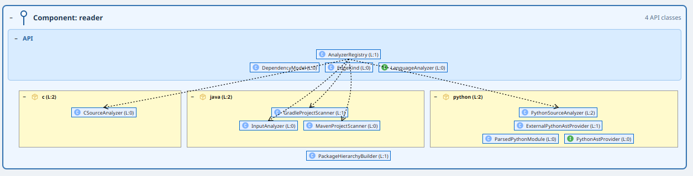

`LanguageAnalyzer` and `AnalyzerRegistry` form the API. `AnalyzerRegistry`
still knows the concrete analyzers, though — the dashed arrows show
dependencies from the impl level into the API, which means a cyclic coupling
between API and impl.

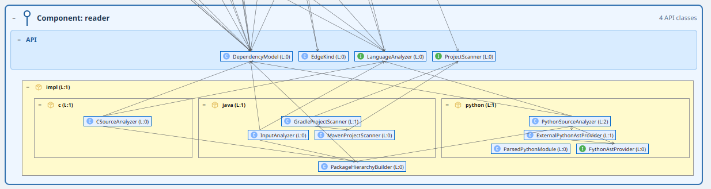

`AnalyzerRegistry` is gone. Avaje Inject takes over registering the
concrete analyzers via service lookup — the API no longer knows the impl.
All incoming dependencies point only to API classes; no arrow goes in the
opposite direction.

---

## 2. `SCCVisualizationHelper` — legacy, can be deleted

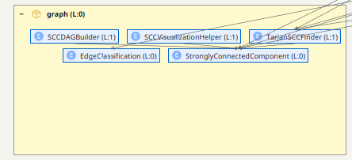

`de.weigend.s202.graph.SCCVisualizationHelper` has not a single caller
outside its own class definition. The class is dead code.

In substance it has been fully replaced by newer mechanisms:

| Method | Replacement |
|---|---|
| `getTangles()` | `DomainModel.getPackageTangles()`, `SCCRenderer` |
| `generateSummary()` / `ArchitectureSummary` | no consumer — never integrated |
| `sortTangleMembers()` | early layout attempt; replaced by `rank(P)` in `LevelCalculator` |

In addition, the name is structurally wrong: a class with "Visualization"
in its name does not belong in the `graph` package (domain graph infrastructure).

**Action:** delete the file.

### Evidence

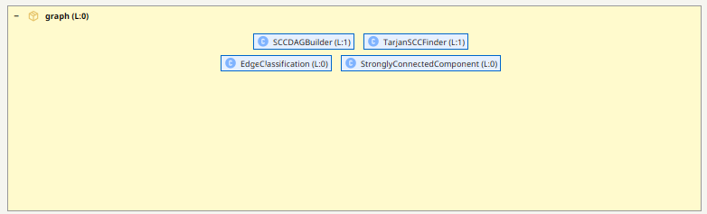

---

## 3. `SCCDAGBuilder` — legacy, can be deleted

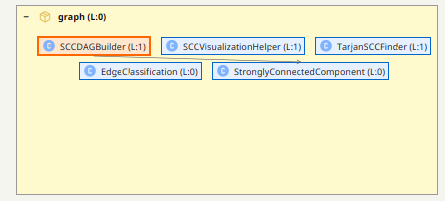

`de.weigend.s202.graph.SCCDAGBuilder` is not called anywhere in production
code. Its only caller is `SCCDAGBuilderTest`, which keeps the class
artificially alive.

Its functionality is fully contained in `LevelCalculator`: it also builds
an SCC DAG and computes levels by longest path — but with the `rank(P)`
mechanism and the package hypothesis. `SCCDAGBuilder` knows neither and
would not deliver correct architecture levels on its own.

**Action:** delete the class and the accompanying `SCCDAGBuilderTest`.

### Evidence

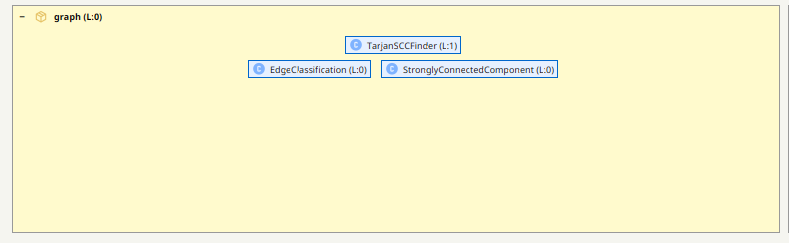

---

## 4. `EdgeClassification` — move, don't delete

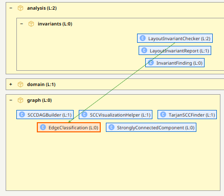

`de.weigend.s202.graph.EdgeClassification` has exactly one caller in
production code: `LayoutInvariantChecker`. No other code needs it.

As a standalone public class in the `graph` package, it suggests a general
usefulness that does not exist. The class is purely an implementation
detail of the invariant check.

**Action:** move it into `LayoutInvariantChecker` as a `private static`
helper class (or make it package-private in the `analysis.invariants`
package if the checker grows too large). Remove it from the `graph` package.

### Evidence

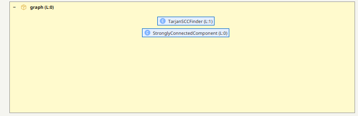

---

## 5. Dissolve the `graph` package — move its content into `domain`

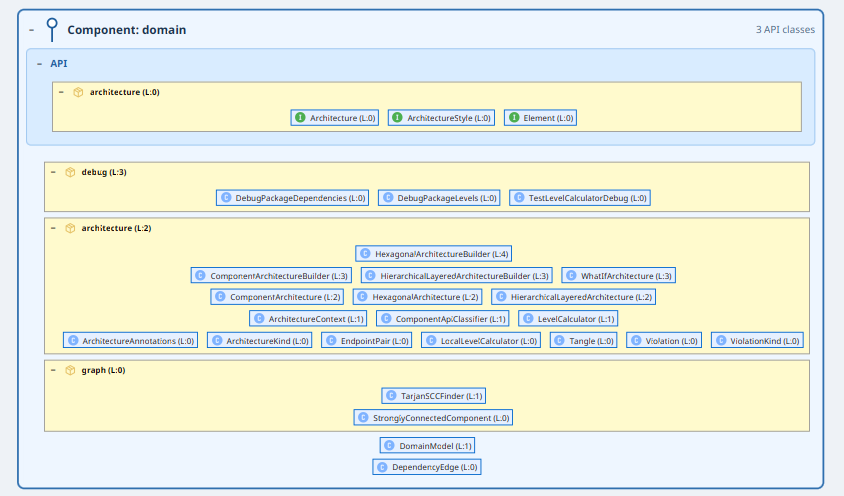

After the deletions in items 2–4, only two classes remain in the `graph`
package: `TarjanSCCFinder` and `StronglyConnectedComponent`.
The package as a level of its own is therefore no longer justified.

### Goal

The `graph` package disappears. Its content moves into `domain`
with a clean API/impl separation:

**Domain API** (publicly visible to `domain`, `analysis`, `ui`):
```
de.weigend.s202.domain.SCCFinder                  ← new interface
de.weigend.s202.domain.StronglyConnectedComponent ← result type, part of the interface
```

`StronglyConnectedComponent` is the return type of `SCCFinder` and therefore
necessarily part of the API — without it, no caller can work with the result.

**Domain impl** (implementation detail, not directly importable):
```
de.weigend.s202.domain.impl.TarjanSCCFinder       ← implements SCCFinder
```

### Interface

```java
public interface SCCFinder {
    List<StronglyConnectedComponent> findSCCs(Map<String, Set<String>> graph);
}
```

### Result

- The `graph` package disappears completely.
- All previous callers (`LevelCalculator`, `LayoutInvariantChecker`,
  `SCCRenderer`, etc.) now import from `domain` instead of `graph`.
- `TarjanSCCFinder` can no longer be instantiated directly from outside.

### Evidence

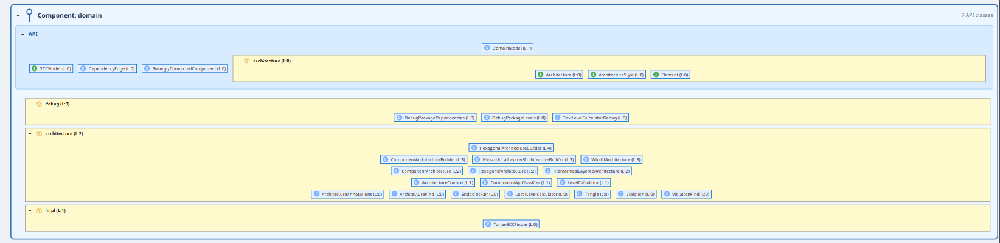

---

## 6. `domain` as a component — cutting the API

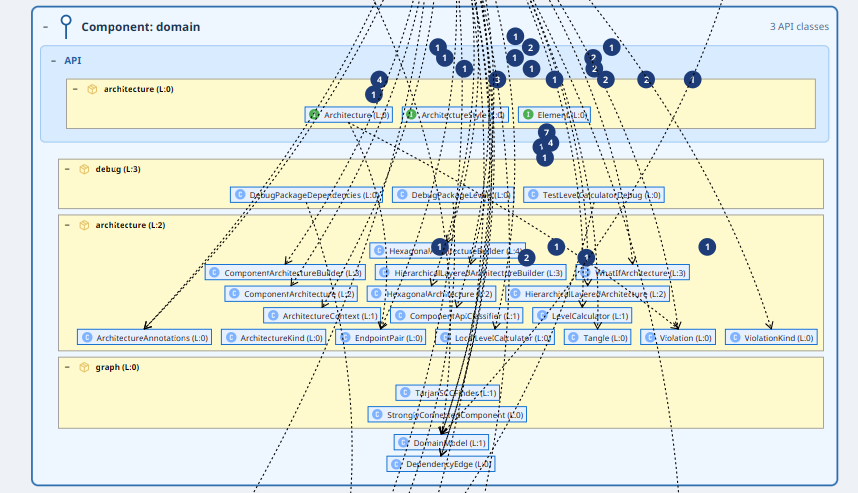

S202 cut the component boundary automatically. The picture shows that
almost all classes are used directly from the UI side. The architecture
interfaces (`Architecture`, `ArchitectureStyle`, `Element`) were already
prepared but not yet used consistently. The many violations arise because
S202 counts access from outside to the impl part of a component as a
violation — only access through the interface is allowed.

### Problem

Today `domain` is not a component but a package namespace. `S202Module`
and the UI instantiate `LevelCalculator`, `LocalLevelCalculator` and all
three builders directly. Everything is implicitly API.

### Two responsibilities

Internally, `domain` has two clearly separable responsibilities:

1. **Computation** — `DependencyModel → DomainModel`
   (`LevelCalculator` + `LocalLevelCalculator`)
2. **Projection** — `DomainModel + Annotations → Architecture`
   (the three builders)

For both, an interface approach already exists or can be introduced.

### Two new/adapted interfaces

```java
// Computation (new)
public interface DomainComputer {
    DomainModel compute(DependencyModel input);
}

// Projection (already exists)
public interface ArchitectureStyle {
    ArchitectureKind kind();
    Architecture build(ArchitectureContext ctx);
}
```

`LevelCalculator` + `LocalLevelCalculator` disappear behind
`DomainComputer`. The three builders disappear behind `ArchitectureStyle`.
`ComponentApiClassifier` then becomes an internal helper of the builders.

### API surface

| Type | Class/interface |
|---|---|
| Interface | `Architecture` |
| Interface | `DomainComputer` (new) |
| Interface | `ArchitectureStyle` |
| Data | `DomainModel` |
| Data | `ArchitectureAnnotations` |
| Data | `ArchitectureContext` |
| Data | `Element` |
| Data | `Tangle` |
| Data | `Violation` |
| Enum | `ArchitectureKind` |
| Enum | `ViolationKind` |

Plus the four concrete architecture projections (see the item below).

### Impl (hidden)

```
LevelCalculator, LocalLevelCalculator  ← impl DomainComputer
HierarchicalLayeredArchitectureBuilder ← impl ArchitectureStyle
ComponentArchitectureBuilder           ← impl ArchitectureStyle
HexagonalArchitectureBuilder           ← impl ArchitectureStyle
ComponentApiClassifier                 ← internal to the builders
```

### Evidence

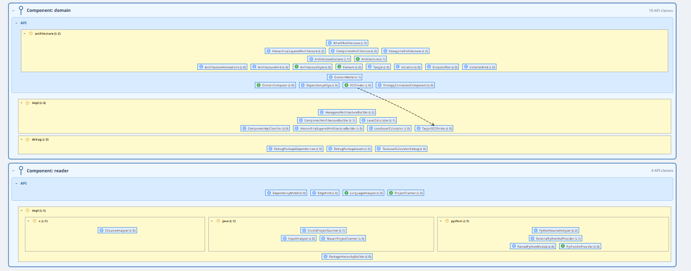

This picture is the counterpart to the violations overview at the start of
section 6 — almost all violations are gone. The only remaining violation is
the dashed line from `SCCFinder` to `TarjanSCCFinder`: the interface still
uses `TarjanSCCFinder` as its `default` implementation and thereby holds a
direct dependency on an impl class. This is removed in a follow-up step.

---

## 7. Replacing `sealed Architecture` — an open interface hierarchy

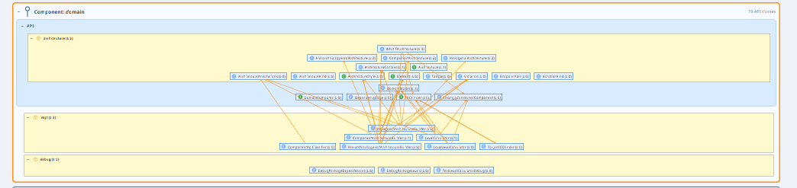

### Problem

`Architecture` is currently a `sealed interface` that permits only
explicitly listed subtypes. This forces an exhaustive switch over all
concrete types wherever it is used. New architecture styles break
existing code.

The deeper problem: the different styles are not variations of the same
concept but models that differ in substance, each with its own domain
concepts:

- **Layered**: level, layer order, back-edges
- **Component**: API classification, component boundaries, bypass detection
- **Hexagonal**: ports, rings, adapter roles, inward/outward direction

A shared `violations()`/`tangles()` interface is the lowest common
denominator and hides these differences.

### Solution: open inheritance instead of sealed

```java
public interface Architecture {
    List<Violation> violations();
    List<Tangle> tangles();
}

public interface LayeredArchitecture extends Architecture {
    List<List<Element>> rows();
    // further layered-specific methods
}

public interface ComponentArchitecture extends Architecture {
    List<ComponentElement> components();
    // further component-specific methods
}

public interface HexagonalArchitecture extends Architecture {
    List<HexRing> rings();
    List<HexPort> ports();
    // further hexagonal-specific methods
}
```

The concrete implementations (`HierarchicalLayeredArchitecture` etc.)
implement the respective sub-interfaces. Since the interface name is then
taken, the implementation classes have to be renamed —
e.g. `HierarchicalLayeredArchitectureImpl` — or the interfaces get
more telling names such as `LayeredView`.

### Advantages over sealed

- New styles don't break existing code
- Every consumer works with exactly the interface it needs,
  no cast, no exhaustive switch
- Style-specific domain concepts can extend the interface naturally
  without touching the shared contract
- When a style grows in substance, its interface grows — independently of
  the others

### Evidence

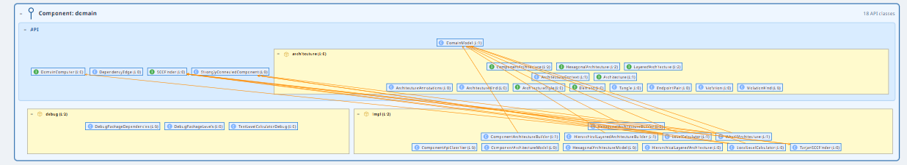

The concrete architecture classes are hidden in `domain.impl`; the
interfaces form the clean API. Package cycles are still visible, though:
a default interface method in `SCCFinder` created a `TarjanSCCFinder`
instance directly and thereby pulled the API level into a dependency on
the impl level. This was resolved in the next step with the lookup pattern.

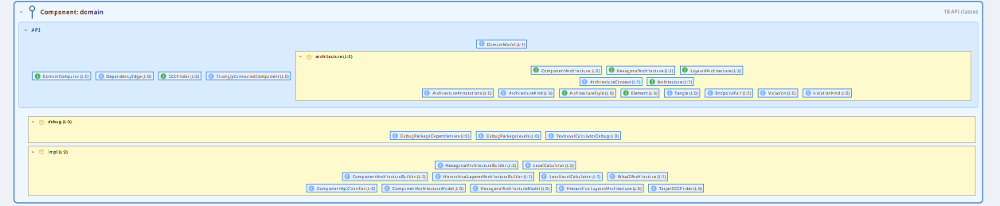

---

## 8. `project` as a component — the `ProjectStore` interface

### Current state

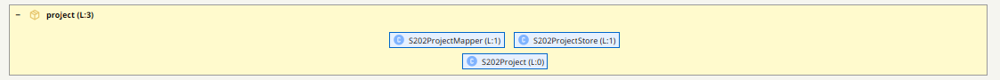

All three classes of the `project` package are imported directly from outside:

| Class | Role |
|---|---|
| `S202Project` | Record with persistence DTOs — the file format |
| `S202ProjectStore` | `save`/`load` on disk (JSON) |
| `S202ProjectMapper` | Conversion domain ↔ DTOs |

`S202Module` instantiates `S202ProjectStore` and `S202ProjectMapper` directly.

### Goal

An interface for the store operation; the mapper becomes an implementation detail:

```java
public interface ProjectStore {
    void save(Path path, S202Project project) throws IOException;
    S202Project load(Path path) throws IOException;
}
```

`S202ProjectStore` implements `ProjectStore`. `S202ProjectMapper` is no
longer public — it is used internally by `S202ProjectStore` and disappears
from the API surface.

`S202Project` remains an API data type as long as the caller assembles the
project itself. In the medium term, the store could offer a higher-level
abstraction (`save(DomainModel, ArchitectureAnnotations, ...)`) — then
`S202Project` becomes an implementation detail too. That is a separate step.

### Result

- The `project` component exports: `ProjectStore` (interface), `S202Project` (data)
- `S202ProjectMapper` and `S202ProjectStore` are hidden impl

### Evidence

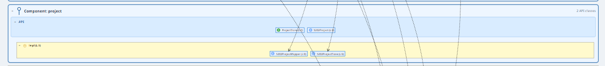

The component has a clear API/impl separation. The dashed lines, however,
still show direct access from `S202Module` to the impl classes
`S202ProjectStore` and `S202ProjectMapper`. In the follow-up step these were
also decoupled with the lookup pattern: `S202Module` uses only
`ProjectStore` and `ProjectMapper` via `Lookup.lookup()`.
The result can be seen in the overall view in section 9.

---

## 9. UI — deliberately outside this step

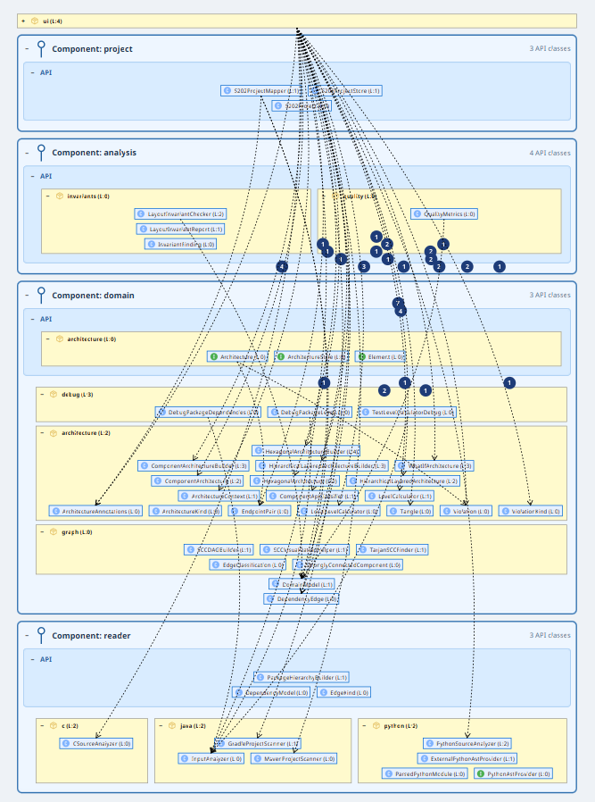

The UI layer (`de.weigend.s202.ui`) stays monolithic in this step.
It is not re-cut as a component.

Improvements to the UI are made surgically where they are concretely
needed — e.g. when a new WFX module requires a clean boundary, or a class
demonstrably carries too much responsibility. No big rewrite.

**What this step delivers:**
The UI layer gets clean counterparts: `LanguageAnalyzer`, `ProjectStore`,
`DomainComputer`, `ArchitectureStyle` — everything it instantiates directly
today is replaced by interfaces. The UI itself does not change its internal
structure in the process.

### Evidence

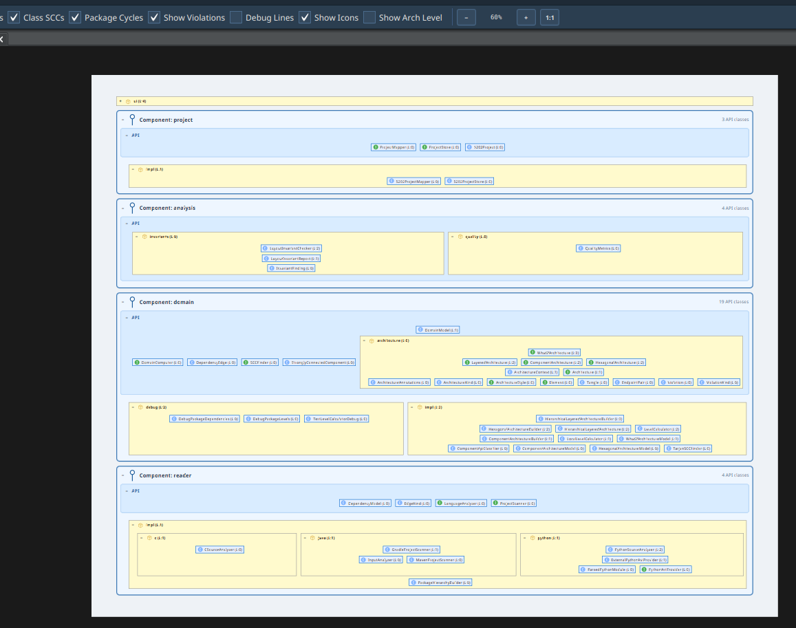

The overall view confirms: all direct access to impl classes has been
removed. Every component boundary is respected — the case study is
complete.

---

## Conclusion: component architecture with all dependencies

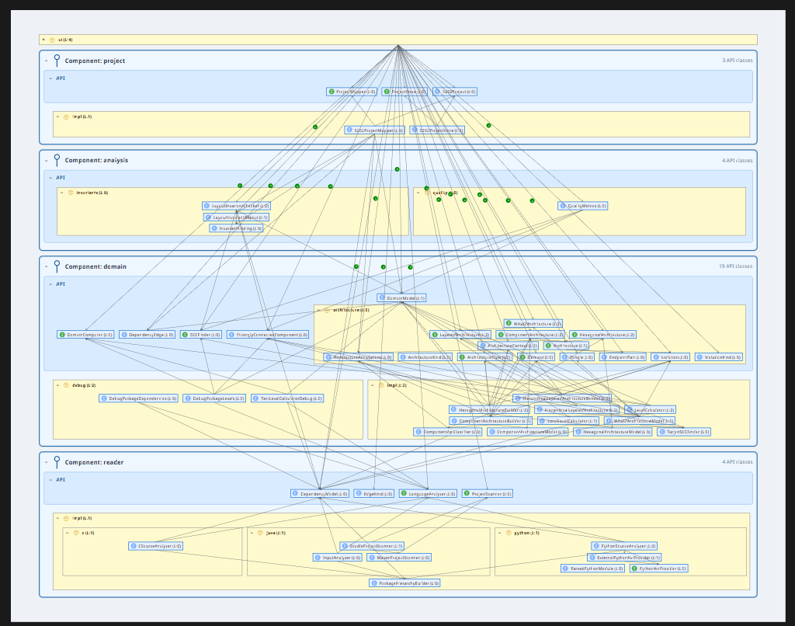

The picture shows the four components in the layered view with all
incoming and outgoing dependencies. Not a single violation arrow is
visible any more — all access goes through the defined API interfaces.
The architecture is measurably clean, and the tool analysed and improved
itself along the way.

---

## 10. One package layout for all components

### Convention: `name` == API, `name.impl` == implementation

The top-level package of a component is its public API.
Implementation details live in the subpackage `name.impl`.

**Advantages:**
- API types have natural, short import paths without `.api.` noise
- Enforceable via `module-info.java`: `exports name` but not `exports name.impl`
- Fits the existing structure — the readers for each language already were
  natural impl subpackages

Because S202's default rule takes `api`, `spi`, `port` and `ports` sub-packages
as the public part of a component, S202 declares this layout explicitly: every
component root carries `@S202Api` and `@S202Component` in its `package-info.java`.

### No JPMS — but a JPMS-compatible design

`module-info.java` is **not** introduced. For a tool of this size that is
developed in an agile way, the benefit is small, while the cost in
refactorings and dependency changes is noticeable — JPMS hinders
fast iteration.

The package layout is, however, designed so that a later JPMS migration is
possible without conceptual changes: API packages would be `exports`,
`*.impl` packages would simply not be exported.

### Applied to all components (state of release 1.9.0)

```
de.weigend.s202.reader               ← API: LanguageAnalyzer, ProjectScanner, DependencyModel, EdgeKind, TypeUse
de.weigend.s202.reader.impl.java     ← impl
de.weigend.s202.reader.impl.python   ← impl
de.weigend.s202.reader.impl.golang   ← impl
de.weigend.s202.reader.impl.javascript ← impl
de.weigend.s202.reader.impl.c        ← impl

de.weigend.s202.domain               ← API: DomainComputer, DomainModel, SCCFinder,
                                            StronglyConnectedComponent, ...
de.weigend.s202.domain.architecture  ← API: Architecture, ArchitectureStyle,
                                            Element, Tangle, Violation, ...
de.weigend.s202.domain.impl          ← impl: LevelCalculator, ContainerLevelizer,
                                             TarjanSCCFinder, all builders

de.weigend.s202.project              ← API: ProjectStore, ProjectMapper, S202Project
de.weigend.s202.project.impl         ← impl: S202ProjectStore, S202ProjectMapper
```

Since this case study, `analysis`, `report.quality` and `report.text` have become
components too, and `LocalLevelCalculator` and `ComponentApiClassifier` have been
replaced by `ContainerLevelizer` and `ComponentStructure` in `domain.impl`.

---
